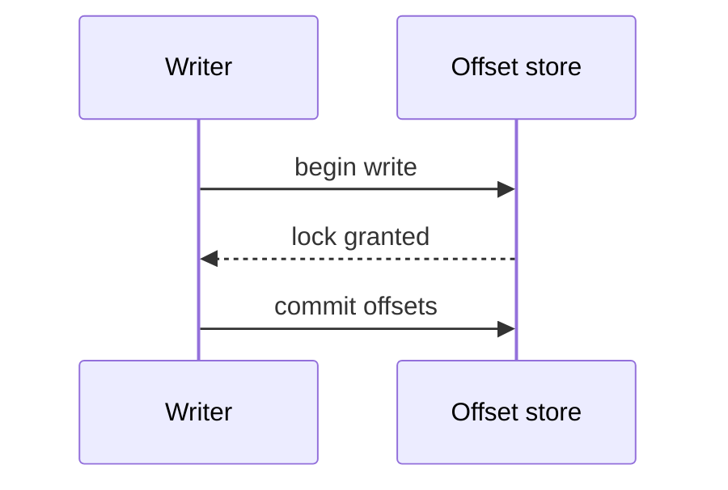

# Calamus Synthesis Implementation Plan

> **For agentic workers:** REQUIRED SUB-SKILL: Use superpowers:subagent-driven-development (recommended) or superpowers:executing-plans to implement this plan task-by-task. Steps use checkbox (`- [ ]`) syntax for tracking.

**Goal:** Ship `skills/calamus-synthesis/`, a read-only sibling skill that turns the Calamus journals into cited writeups with validated Mermaid diagrams, verbatim code excerpts, and lint-checked prose.

**Architecture:** A deterministic engine (`scripts/calamus-synth` plus `scripts/lib/`) extracts facts and signals, generates and verifies diagrams and excerpts, and lints prose. The model step (the analyst) reads `facts.json`, writes `analysis.json` and the drafts, and follows procedure in `references/`. The engine imports the sibling `skills/calamus/scripts/lib` for parsing and never writes a journal.

**Tech Stack:** Python 3 stdlib, bash 3.2, `git` CLI (optional at run time), Mermaid source text. Tests: `unittest` and the existing shell harness in `tests/lib.sh`.

**Spec:** `docs/superpowers/specs/2026-10-15-calamus-synthesis-design.md`

## Global Constraints

- Hooks exit 0 and print nothing: this skill adds no hooks.
- Journals are append-only: no command opens a journal for writing. A test compares journal bytes before and after every command.
- Model strings live only in `skills/calamus/assets/calamus.env`. No file under `skills/calamus-synthesis/` names a model; the agent brief has no `model:` field.
- Config is data: `synth.conf`, `style.conf`, and voice front matter are parsed line by line, never sourced or evaluated.
- Outputs and journals never contain absolute local paths. Pre-voice snapshots live in `.calamus/state/`, never committed.
- macOS `/bin/bash` 3.2 and Python 3 stdlib only. `git` is the only external command, and only when present.
- `SKILL.md` at most 150 lines; each file in `references/` at most 300 lines.
- Exit codes: 0 ok, 2 usage or input error, 3 check failure, 4 excerpt refused.
- Same inputs produce byte-identical `facts.json` and `.mmd` files.
- No model call in any script or test. Run `bash tests/run.sh` before every commit.
- Commits: local only, on `refactor/calamus`, conventional messages, no AI attribution trailers (user instruction overrides the default trailer).

## Review Focus

1. **Hand-written legacy entries in an md journal** (ids ending `-0000-xxxx`, no variant fields). Expected: extract keeps them, `time` is empty, nothing crashes. Test added to Task 2.
2. **Bursts of same-day entries** (median gap 0). Expected: no gap signal unless a gap reaches `gap_min_days`; no division by zero. Test added to Task 3.
3. **Excerpt of a path deleted or renamed before the resolved commit.** Expected: exit 4 with "not found at commit", never a traceback. Test added to Task 4.
4. **Malformed `analysis.json`** (invalid JSON, wrong top-level type). Expected: exit 2 naming the file, no traceback. Test added to Task 5.
5. **`check` on a first draft with no snapshot yet.** Expected: fidelity comparison is skipped with no failure; everything else runs. Test added to Task 8.

## File Map

| Path | Responsibility | Task |
|---|---|---|
| `skills/calamus-synthesis/scripts/calamus-synth` | Dispatcher: usage, sibling check, exit codes | 1 |
| `scripts/lib/base.py` | Sibling import, conf parsing, entry times, errors | 1 |
| `scripts/lib/commands.py` | One `cmd_<name>(argv)` per subcommand | 1, then each task adds its command |
| `assets/synth.conf`, `assets/style.conf` | Engine and lint settings as data | 1 |
| `scripts/lib/facts.py` | Load journals, slim records, sessions, stats, `facts.json` | 2, 3, 4 |
| `scripts/lib/signals.py` | Boundary and record signals | 3 |
| `scripts/lib/boundaries.py` | Candidate scoring and suppression | 3 |
| `scripts/lib/excerpt.py` | Commit resolution, selection, guards, verification | 4 |
| `scripts/lib/analysis.py` | `analysis.json` validation | 5 |
| `scripts/lib/mermaid.py` | Label safety and the four generated diagrams | 5 |
| `scripts/lib/mmdlint.py` | Structural Mermaid lint | 6 |
| `scripts/lib/embed.py` | Diagram embedding and embed verification | 6 |
| `scripts/lib/lint.py` | Prose extraction, style rules, bands | 7 |
| `scripts/lib/voice.py` | Profile lookup and parsing | 7 |
| `scripts/lib/fidelity.py` | Token multisets, absolute paths, uncited findings | 8 |
| `scripts/lib/render_html.py` | Standalone diagram page | 9 |
| `SKILL.md`, `references/*.md`, `agents/journal-analyst.md`, `assets/*.json`, `assets/voice.template.md` | Skill layer | 10 |
| `packaging/*/skills/calamus-synthesis`, `calamus-install`, docs | Packaging and install | 11 |
| `tests/synth_fixture.py` | Deterministic journals with planted phases | 2 |
| `tests/test_synth_*.py`, `tests/test_synth.sh`, `tests/test_synth_skill.sh` | Tests | each task |

All `scripts/` and `assets/` paths above are under `skills/calamus-synthesis/`.

---

### Task 1: Skeleton, configuration, and dispatcher

**Files:**
- Create: `skills/calamus-synthesis/scripts/calamus-synth`
- Create: `skills/calamus-synthesis/scripts/lib/base.py`
- Create: `skills/calamus-synthesis/scripts/lib/commands.py`
- Create: `skills/calamus-synthesis/assets/synth.conf`
- Create: `skills/calamus-synthesis/assets/style.conf`
- Modify: `tests/helpers.py` (add the synthesis lib to `sys.path`)
- Test: `tests/test_synth_base.py`, `tests/test_synth.sh`

**Interfaces:**
- Produces: `base.use_calamus()`, `base.load_conf(path) -> dict[str, list[str]]`, `base.num(conf, key) -> float`, `base.items(conf, key) -> list[str]`, `base.default_conf(name)`, `base.entry_time(rec_id, date, legacy=False) -> datetime`, `base.MissingSibling`, `base.UsageError`, `base.SKILL`, `base.ASSETS`. `commands.py` exposes `cmd_<name>(argv) -> int`; the dispatcher lists commands from those names.

- [ ] **Step 1: Write the failing tests**

Append to `tests/helpers.py`:

```python
SYNTH = os.path.join(REPO, "skills", "calamus-synthesis")
SYNTH_LIB = os.path.join(SYNTH, "scripts", "lib")
if SYNTH_LIB not in sys.path:
    sys.path.insert(0, SYNTH_LIB)
```

Create `tests/test_synth_base.py`:

```python
import datetime
import os
import tempfile
import unittest

import helpers  # noqa: F401  (path setup)
import base


class ConfTests(unittest.TestCase):
    def test_parses_repeated_keys_and_comments(self):
        with tempfile.NamedTemporaryFile("w", suffix=".conf", delete=False) as f:
            f.write("# comment\nwindow = 4\nphrase = a b\nphrase = c\n\n")
        conf = base.load_conf(f.name)
        self.assertEqual(conf, {"window": ["4"], "phrase": ["a b", "c"]})
        self.assertEqual(base.num(conf, "window"), 4.0)
        self.assertEqual(base.items(conf, "phrase"), ["a b", "c"])
        self.assertEqual(base.items(conf, "absent"), [])

    def test_rejects_lines_without_equals(self):
        with tempfile.NamedTemporaryFile("w", suffix=".conf", delete=False) as f:
            f.write("rm -rf /\n")
        with self.assertRaises(base.UsageError):
            base.load_conf(f.name)

    def test_shipped_conf_has_every_engine_key(self):
        conf = base.default_conf("synth.conf")
        for key in ("min_entries", "window", "gap_factor", "gap_min_days", "jsd_min", "jaccard_min",
                    "tolerance", "phase_threshold", "weight_gap", "weight_tag_shift",
                    "weight_file_turnover", "weight_explicit_pivot", "weight_architecture",
                    "followup_overlap", "excerpt_grace_hours", "excerpt_max_lines", "max_excerpts",
                    "label_max_chars", "max_nodes", "timeline_max_events", "max_pivots",
                    "max_leaves", "max_extra_diagrams", "mermaid_cdn"):
            self.assertIn(key, conf)


class EntryTimeTests(unittest.TestCase):
    def test_time_from_id(self):
        self.assertEqual(base.entry_time("20260105-1432-ab12", "2026-01-05"),
                         datetime.datetime(2026, 1, 5, 14, 32))

    def test_legacy_resolves_to_end_of_day(self):
        self.assertEqual(base.entry_time("20260105-0000-ab12", "2026-01-05", legacy=True),
                         datetime.datetime(2026, 1, 5, 23, 59))
        self.assertEqual(base.entry_time("", "2026-01-05"), datetime.datetime(2026, 1, 5, 23, 59))


class SiblingTests(unittest.TestCase):
    def test_sibling_lib_is_found(self):
        base.use_calamus()
        self.assertTrue(os.path.isfile(os.path.join(base.CALAMUS_LIB, "records.py")))


if __name__ == "__main__":
    unittest.main()
```

Create `tests/test_synth.sh`:

```bash
#!/usr/bin/env bash
# calamus-synth command-line behavior.
. "$(dirname "$0")/lib.sh"
SYN_DIR="$REPO_ROOT/skills/calamus-synthesis"
SYN="$SYN_DIR/scripts/calamus-synth"

"$SYN" >/dev/null 2>&1; assert_eq 2 "$?" "no command is a usage error"
"$SYN" bogus >/dev/null 2>&1; assert_eq 2 "$?" "unknown command is a usage error"
err="$("$SYN" 2>&1 >/dev/null)"; assert_contains "$err" "usage: calamus-synth" "usage printed to stderr"

# Missing sibling: a lone copy of the skill exits 2 and names calamus.
T="$(mktemp -d "${TMPDIR:-/tmp}/synth-alone.XXXXXX")"
cp -R "$SYN_DIR" "$T/calamus-synthesis"
err="$("$T/calamus-synthesis/scripts/calamus-synth" extract 2>&1 >/dev/null)"; rc=$?
assert_eq 2 "$rc" "missing sibling exits 2"
assert_contains "$err" "calamus skill is missing" "missing sibling named"

finish
```

- [ ] **Step 2: Run tests to verify they fail**

Run: `python3 -m unittest tests/test_synth_base.py -v; bash tests/test_synth.sh`
Expected: FAIL with `ModuleNotFoundError: No module named 'base'` and missing `calamus-synth`.

- [ ] **Step 3: Write the implementation**

`skills/calamus-synthesis/scripts/lib/base.py`:

```python
"""Shared setup for calamus-synth: sibling import, config parsing, entry times."""
import datetime
import os
import re
import sys

LIB = os.path.dirname(os.path.realpath(__file__))
SKILL = os.path.dirname(os.path.dirname(LIB))
ASSETS = os.path.join(SKILL, "assets")
CALAMUS_LIB = os.path.join(os.path.dirname(SKILL), "calamus", "scripts", "lib")
ID_RE = re.compile(r"^(\d{8})-(\d{4})-[0-9a-z]+$")


class MissingSibling(Exception):
    """Exit 2: the calamus skill is not installed next to this one."""


class UsageError(Exception):
    """Exit 2: bad arguments or unreadable input."""


def use_calamus():
    """Put the sibling calamus engine on sys.path, or raise MissingSibling."""
    if not os.path.isfile(os.path.join(CALAMUS_LIB, "records.py")):
        raise MissingSibling("the calamus skill is missing; install it next to calamus-synthesis")
    if CALAMUS_LIB not in sys.path:
        sys.path.insert(0, CALAMUS_LIB)


def load_conf(path):
    """Parse `key = value` lines into {key: [values]}. Never sourced or evaluated."""
    conf = {}
    with open(path, encoding="utf-8") as f:
        for n, line in enumerate(f, 1):
            line = line.strip()
            if not line or line.startswith("#"):
                continue
            if "=" not in line:
                raise UsageError("%s:%d: expected key = value" % (os.path.basename(path), n))
            key, value = (part.strip() for part in line.split("=", 1))
            conf.setdefault(key, []).append(value)
    return conf


def num(conf, key):
    return float(conf[key][-1])


def items(conf, key):
    return list(conf.get(key, []))


def default_conf(name):
    return load_conf(os.path.join(ASSETS, name))


def entry_time(rec_id, date, legacy=False):
    """When an entry was logged; legacy and timeless ids resolve to the end of their date."""
    m = ID_RE.match(rec_id or "")
    if m and not legacy and m.group(2) != "0000":
        return datetime.datetime.strptime(m.group(1) + m.group(2), "%Y%m%d%H%M")
    return datetime.datetime.strptime(date, "%Y-%m-%d").replace(hour=23, minute=59)
```

`skills/calamus-synthesis/scripts/lib/commands.py`:

```python
"""Subcommands for calamus-synth. Each cmd_<name>(argv) returns an exit code."""
import argparse  # noqa: F401  (used by the commands added in later tasks)
import os  # noqa: F401
import sys  # noqa: F401

import base  # noqa: F401
```

`skills/calamus-synthesis/scripts/calamus-synth` (mode 755):

```python
#!/usr/bin/env python3
"""Turn Calamus journals into writeups, diagrams, and code excerpts. Read-only on journals.

usage: calamus-synth <command> [options]
  extract   [--root DIR] [--since YYYY-MM-DD] [--out DIR]
  diagrams  DIR                         facts.json + analysis.json -> .mmd files
  excerpt   --id ID (--journaled | --path P (--symbol NAME | --lines A-B)) [--at REV]
            [--diff [--from REV]] [--max-lines N] [--root DIR]
  embed     DIR                         copy .mmd files into their marked blocks
  snapshot  DIR [--root DIR]            keep the pre-voice draft under .calamus/state/
  check     DIR [--root DIR] [--voice PATH] [--mmdc]
  render    DIR --html                  standalone HTML page, only on request

exit codes: 0 ok, 2 usage or input error, 3 check failure, 4 excerpt refused
"""
import os
import sys

sys.path.insert(0, os.path.join(os.path.dirname(os.path.realpath(__file__)), "lib"))
import base  # noqa: E402

USAGE = __doc__.split("\n\n", 1)[1]


def main(argv):
    try:
        base.use_calamus()
        import commands
        names = sorted(n[4:] for n in dir(commands) if n.startswith("cmd_"))
        if not argv or argv[0] not in names:
            sys.stderr.write(USAGE)
            return 2
        return getattr(commands, "cmd_" + argv[0])(argv[1:])
    except (base.MissingSibling, base.UsageError) as e:
        sys.stderr.write("calamus-synth: %s\n" % e)
        return 2


if __name__ == "__main__":
    sys.exit(main(sys.argv[1:]))
```

`skills/calamus-synthesis/assets/synth.conf`:

```
# calamus-synthesis engine settings. Parsed as data, never sourced.
# Tuned against tests/synth_fixture.py; change with the fixture tests green.

# Signals and candidates (spec 4.2, 4.3)
min_entries = 8
window = 4
gap_factor = 3
gap_min_days = 7
jsd_min = 0.6
jaccard_min = 0.7
tolerance = 1
phase_threshold = 2
weight_gap = 1
weight_tag_shift = 1
weight_file_turnover = 1
weight_explicit_pivot = 2
weight_architecture = 0.5
followup_overlap = 0.6

# Code excerpts (spec 8)
excerpt_grace_hours = 12
excerpt_max_lines = 25
max_excerpts = 4

# Diagrams (spec 7)
label_max_chars = 48
max_nodes = 30
timeline_max_events = 4
max_pivots = 7
max_leaves = 6
max_extra_diagrams = 3
mermaid_cdn = https://cdn.jsdelivr.net/npm/mermaid@11.4.1/dist/mermaid.min.js
```

`skills/calamus-synthesis/assets/style.conf`:

```
# Style lint lists and bands (spec 9.4, 9.6) and excerpt secret patterns (8.4).
# Parsed as data, never sourced. A voice profile may override band_* keys
# and extend the lists.

stock_phrase = it is worth noting
stock_phrase = it's worth noting
stock_phrase = plays a crucial role
stock_phrase = plays a key role
stock_phrase = a testament to
stock_phrase = delve
stock_phrase = delves
stock_phrase = leverages
stock_phrase = leveraging
stock_phrase = leveraged
stock_phrase = seamless
stock_phrase = seamlessly
stock_phrase = robust
stock_phrase = navigate the complexities
stock_phrase = in today's
stock_phrase = game-changer
stock_phrase = cutting-edge
stock_phrase = rich tapestry
filler_transition = Additionally
filler_transition = Furthermore
filler_transition = Moreover
filler_transition = In conclusion
filler_transition = Overall
hedge = may
hedge = might
hedge = could
hedge = possibly
hedge = potentially
hedge = perhaps
hedge = arguably
intensifier = very
intensifier = really
intensifier = extremely
intensifier = significantly

band_mean_len = 16-21
band_long_pct_max = 15
band_short_pct = 25-35
band_para_sents = 2-3
band_em_dash_max = 0
band_exclaim_max = 0
band_first_person_max = 0
band_contraction_max = 0
long_words = 30
short_words = 12
band_min_sentences = 5
bullet_ratio_max = 0.4
max_citations = 3

secret_pattern = -----BEGIN [A-Z ]*PRIVATE KEY-----
secret_pattern = AKIA[0-9A-Z]{16}
secret_pattern = gh[pousr]_[A-Za-z0-9]{36}
secret_pattern = sk-[A-Za-z0-9_-]{20,}
secret_pattern = xox[abpr]-[A-Za-z0-9-]{10,}
secret_pattern = (?i)(api[_-]?key|secret|token|password)\s*[:=]\s*["'][^"'\s]{8,}["']
```

- [ ] **Step 4: Run tests to verify they pass**

Run: `chmod +x skills/calamus-synthesis/scripts/calamus-synth && python3 -m unittest tests/test_synth_base.py -v && bash tests/test_synth.sh`
Expected: PASS (`test_synth.sh: 5 assertions passed`).

- [ ] **Step 5: Run the full suite and commit**

```bash
bash tests/run.sh
git add skills/calamus-synthesis tests/helpers.py tests/test_synth_base.py tests/test_synth.sh
git commit -m "feat(synthesis): add calamus-synth skeleton and config"
```

---

### Task 2: Fixture generator and `extract`

**Files:**
- Create: `tests/synth_fixture.py`
- Create: `skills/calamus-synthesis/scripts/lib/facts.py`
- Modify: `skills/calamus-synthesis/scripts/lib/commands.py` (add `cmd_extract`)
- Test: `tests/test_synth_facts.py`, `tests/test_synth.sh`

**Interfaces:**
- Consumes: `base.*` (Task 1); calamus `journal.resolve`, `records.parse`, `schema.normalize`, `schema.validate`, `render.render`, `render.header`, `cli.project_root`.
- Produces: `facts.load(root) -> (info, entries, markers, warnings)` where `entries` are normalized calamus records sorted by `(date, id)`; `facts.entry(root, rec_id) -> dict` (full normalized record, raises `UsageError`); `facts.slim(rec) -> dict`; `facts.full_text(rec) -> str` (lowercase); `facts.build(root, conf, since=None) -> dict`; `facts.dump(facts) -> str`. Slim record keys: `id, journal, variant, date, time, tag, title, files, summary, evidence, followups, pivot_text, has_code, legacy, crosslog`. Fixture: `synth_fixture.engineering()`, `synth_fixture.product(eng)`, `synth_fixture.write(root, fmt, eng, prod)`, `synth_fixture.PLANTED == [8, 16]`, `synth_fixture.PIVOT_POS == 16`.

- [ ] **Step 1: Write the fixture generator**

`tests/synth_fixture.py`:

```python
"""Deterministic synthetic journals with planted phases, one pivot, and known gaps.

Engineering: 24 entries in three phases of 8. Phase 2 starts after a 21-day
gap with a new tag mix; phase 3 starts with a CP-PIVOT entry and a new file
set. Planted phase starts are sequence positions 8 and 16.
"""
import datetime
import os

import helpers  # noqa: F401  (path setup)
import render
import schema

PHASES = [
    ("2026-01-05", 8, ["CP-ARCHITECTURE", "CP-TESTING"], ["core/parse.py", "core/model.py"]),
    ("2026-02-02", 8, ["CP-DEBUG", "CP-TESTING", "CP-REFACTOR"], ["core/parse.py", "cli/main.py"]),
    ("2026-02-11", 8, ["CP-INTEGRATION", "CP-MILESTONE"], ["web/app.ts", "web/routes.ts"]),
]
PLANTED = [8, 16]
PIVOT_POS = 16
STEMS = {"engineering": "dev_journal", "product": "product_insights"}


def engineering():
    out, n = [], 0
    for pi, (start, count, tags, files) in enumerate(PHASES):
        d0 = datetime.date.fromisoformat(start)
        for k in range(count):
            n += 1
            d = d0 + datetime.timedelta(days=k)
            path = files[k % len(files)]
            out.append({
                "record": "entry", "journal": "engineering", "variant": "lightweight",
                "id": "%s-1000-%04x" % (d.strftime("%Y%m%d"), n),
                "tag": "CP-PIVOT" if (pi == 2 and k == 0) else tags[k % len(tags)],
                "date": d.isoformat(), "title": "Phase %d step %d" % (pi + 1, k + 1),
                "summary": "Worked on %s." % path, "files": [path],
                "tradeoff": "Kept the change small.",
                "evidence": {"status": "verified", "text": "Tests pass."},
                "followups": [],
            })
    out[1]["followups"] = ["Measure parse latency"]           # closed by entry 9
    out[9]["summary"] = "Measured parse latency at 4 ms."
    out[5]["followups"] = ["Benchmark the tokenizer cache"]   # never closed
    out[-1]["evidence"] = {"status": "unverified", "text": "Not yet measured."}
    return out


def product(eng):
    rows = [("2026-01-07", "PI-USER-PAIN", "Strong"), ("2026-01-20", "PI-UX-FRICTION", "Weak"),
            ("2026-02-03", "PI-FEATURE-IDEA", "Medium"), ("2026-02-12", "PI-POSITIONING", "Strong"),
            ("2026-02-14", "PI-UX-FRICTION", "Medium"), ("2026-02-16", "PI-TRUST", "Weak")]
    out = []
    for i, (date, tag, strength) in enumerate(rows):
        out.append({
            "record": "entry", "journal": "product", "variant": "lightweight",
            "id": "%s-1100-%04x" % (date.replace("-", ""), 100 + i), "tag": tag, "date": date,
            "title": "Insight %d" % (i + 1), "observation": ["Users reported issue %d." % (i + 1)],
            "why": ["Reason %d." % (i + 1)],
            "evidence": {"source": "Interview notes", "strength": strength},
            "next_step": ["Follow up."],
        })
    pivot = eng[PIVOT_POS]
    out[3]["crosslog"] = {"journal": "engineering", "tag": pivot["tag"], "date": pivot["date"],
                          "title": pivot["title"], "note": "Engineering root cause"}
    return out


def write(root, fmt, eng, prod):
    """Write both journals in one format, the way calamus-convert renders them."""
    os.makedirs(os.path.join(root, "docs"), exist_ok=True)
    for jname, recs in (("engineering", eng), ("product", prod)):
        if recs is None:
            continue
        body = [render.render(schema.normalize(r), fmt, ext=fmt) for r in recs]
        text = render.header(jname, fmt) + ("\n" + "\n".join(body) if fmt == "md" and body else "".join(body))
        with open(os.path.join(root, "docs", "%s.%s" % (STEMS[jname], fmt)), "w", encoding="utf-8") as f:
            f.write(text)
```

- [ ] **Step 2: Write the failing tests**

`tests/test_synth_facts.py`:

```python
import json
import os
import shutil
import tempfile
import unittest

import helpers  # noqa: F401
import synth_fixture as fx

import base
import facts

CONF = base.default_conf("synth.conf")


def tmp_root(fmt="jsonl", eng=None, prod=None):
    root = tempfile.mkdtemp()
    eng = fx.engineering() if eng is None else eng
    fx.write(root, fmt, eng, fx.product(fx.engineering()) if prod is None else prod)
    return root


class ExtractTests(unittest.TestCase):
    def test_records_are_slim_and_sorted(self):
        f = facts.build(tmp_root(), CONF)
        self.assertEqual(len(f["records"]), 30)
        dates = [(r["date"], r["id"]) for r in f["records"]]
        self.assertEqual(dates, sorted(dates))
        first = f["records"][0]
        self.assertEqual(sorted(first), sorted([
            "id", "journal", "variant", "date", "time", "tag", "title", "files", "summary",
            "evidence", "followups", "pivot_text", "has_code", "legacy", "crosslog"]))
        self.assertEqual(first["time"], "10:00")

    def test_sequence_is_engineering_when_enough(self):
        f = facts.build(tmp_root(), CONF)
        self.assertEqual(len(f["sequence"]), 24)
        eng_ids = [r["id"] for r in f["records"] if r["journal"] == "engineering"]
        self.assertEqual(f["sequence"], eng_ids)

    def test_sequence_falls_back_to_all_entries(self):
        f = facts.build(tmp_root(eng=fx.engineering()[:6]), CONF)
        self.assertEqual(len(f["sequence"]), 12)

    def test_crosslog_resolves_to_id(self):
        f = facts.build(tmp_root(), CONF)
        linked = [r for r in f["records"] if r["crosslog"]]
        self.assertEqual(len(linked), 1)
        self.assertEqual(linked[0]["crosslog"], fx.engineering()[fx.PIVOT_POS]["id"])

    def test_unmatched_crosslog_warns(self):
        prod = fx.product(fx.engineering())
        prod[3]["crosslog"]["title"] = "No such entry"
        f = facts.build(tmp_root(prod=prod), CONF)
        self.assertTrue(any("unmatched cross-log" in w for w in f["warnings"]))

    def test_stats_and_supersession_warning(self):
        f = facts.build(tmp_root(), CONF)
        self.assertEqual(f["stats"]["entries"], {"engineering": 24, "product": 6})
        self.assertEqual(f["stats"]["first"], "2026-01-05")
        self.assertEqual(f["stats"]["tags"]["CP-PIVOT"], 1)
        self.assertTrue(any("supersession" in w for w in f["warnings"]))

    def test_since_filters(self):
        f = facts.build(tmp_root(), CONF, since="2026-02-11")
        self.assertTrue(all(r["date"] >= "2026-02-11" for r in f["records"]))

    def test_format_parity(self):
        outs = []
        for fmt in ("md", "xml", "jsonl"):
            f = facts.build(tmp_root(fmt), CONF)
            f.pop("journals")
            outs.append(facts.dump(f))
        self.assertEqual(outs[0], outs[1])
        self.assertEqual(outs[1], outs[2])

    def test_dump_is_deterministic(self):
        root = tmp_root()
        self.assertEqual(facts.dump(facts.build(root, CONF)), facts.dump(facts.build(root, CONF)))
        self.assertTrue(facts.dump(facts.build(root, CONF)).endswith("}\n"))

    def test_legacy_md_entry_is_kept(self):  # Review Focus 1
        root = tmp_root("md")
        with open(os.path.join(root, "docs", "dev_journal.md"), "a", encoding="utf-8") as f:
            f.write("\n### [CP-DEBUG] | 2026-03-01: Hand-written note\n\nSomething broke and was fixed.\n")
        f = facts.build(root, CONF)
        legacy = [r for r in f["records"] if r["legacy"]]
        self.assertEqual(len(legacy), 1)
        self.assertEqual(legacy[0]["time"], "")

    def test_missing_journals_is_usage_error(self):
        with self.assertRaises(base.UsageError):
            facts.build(tempfile.mkdtemp(), CONF)

    def test_entry_lookup(self):
        root = tmp_root()
        eng = fx.engineering()
        self.assertEqual(facts.entry(root, eng[3]["id"])["title"], eng[3]["title"])
        with self.assertRaises(base.UsageError):
            facts.entry(root, "20990101-0000-ffff")


if __name__ == "__main__":
    unittest.main()
```

Append to `tests/test_synth.sh` before `finish`:

```bash
# extract: writes facts.json, stays read-only, and is deterministic.
R="$(mk_repo)"
python3 - "$R" "$REPO_ROOT/tests" <<'PY'
import sys
sys.path.insert(0, sys.argv[2])
import synth_fixture as fx
eng = fx.engineering()
fx.write(sys.argv[1], "md", eng, fx.product(eng))
PY
before="$(cat "$R/docs/dev_journal.md" "$R/docs/product_insights.md" | shasum)"
(cd "$R" && "$SYN" extract --out docs/writeups/t >/dev/null); assert_eq 0 "$?" "extract exits 0"
assert_file "$R/docs/writeups/t/facts.json" "facts.json written"
one="$(cat "$R/docs/writeups/t/facts.json")"
two="$(cd "$R" && "$SYN" extract)"
assert_eq "$one" "$two" "extract is deterministic"
assert_not_contains "$one" "$R" "facts.json has no absolute paths"
after="$(cat "$R/docs/dev_journal.md" "$R/docs/product_insights.md" | shasum)"
assert_eq "$before" "$after" "extract leaves journals byte-identical"
(cd "$R" && "$SYN" extract --since 2026-13-45 >/dev/null 2>&1); assert_eq 2 "$?" "bad --since exits 2"
```

- [ ] **Step 3: Run tests to verify they fail**

Run: `python3 -m unittest tests/test_synth_facts.py -v`
Expected: FAIL with `No module named 'facts'`.

- [ ] **Step 4: Write the implementation**

`skills/calamus-synthesis/scripts/lib/facts.py`:

```python
"""Build facts.json from the journals. Read-only: journals are opened for reading only."""
import collections
import json
import os

import base

base.use_calamus()
import journal  # noqa: E402
import records  # noqa: E402
import schema  # noqa: E402

VERSION = 1
SUPERSESSION = "supersession signal omitted: the entry schema has no supersede or revert field"


def load(root):
    """Return (info, entries, markers, warnings); entries sorted by (date, id)."""
    info, entries, markers, warnings = {}, [], [], []
    for jname in ("engineering", "product"):
        path, fmt, warning = journal.resolve(root, jname, os.environ.get("CALAMUS_FORMAT"))
        if warning:
            warnings.append(warning)
        if not os.path.exists(path):
            continue
        info[jname] = {"path": os.path.relpath(path, root), "format": fmt}
        try:
            recs = records.parse(path)
        except (ValueError, OSError) as e:
            raise base.UsageError("cannot read %s: %s" % (os.path.relpath(path, root), e))
        for rec in recs:
            norm = schema.normalize(rec)
            if norm["record"] == "marker":
                markers.append(norm)
                continue
            errs = [] if norm.get("legacy") else schema.validate(norm)
            if errs:
                warnings.append("skipped %s: %s" % (norm.get("id") or "an entry", "; ".join(errs)))
                continue
            entries.append(norm)
    if not info:
        raise base.UsageError("no journals under docs/; run calamus-init first")
    entries.sort(key=lambda r: (r["date"], r["id"]))
    return info, entries, markers, warnings


def entry(root, rec_id):
    for rec in load(root)[1]:
        if rec["id"] == rec_id:
            return rec
    raise base.UsageError("no entry with id %s" % rec_id)


def _files(rec):
    return list(rec.get("files") or []) + list((rec.get("impl") or {}).get("files") or [])


def _summary(rec):
    text = rec.get("summary") or (rec.get("design") or {}).get("choice") or " ".join(rec.get("observation") or [])
    text = text or rec.get("body", "")
    return text if len(text) <= 240 else text[:239].rsplit(" ", 1)[0] + "…"


def _evidence(rec):
    ev = rec.get("evidence")
    if rec["journal"] == "product":
        return (ev or {}).get("strength", "") if isinstance(ev, dict) else ""
    if rec["variant"] == "full":
        return "verified" if rec.get("verification") else "unverified"
    return ev.get("status", "") if isinstance(ev, dict) else ""


def _strings(value):
    if isinstance(value, str):
        yield value
    elif isinstance(value, dict):
        for v in value.values():
            yield from _strings(v)
    elif isinstance(value, list):
        for v in value:
            yield from _strings(v)


def full_text(rec):
    skip = ("record", "journal", "variant", "schema", "id", "raw")
    return " ".join(s for k, v in rec.items() if k not in skip for s in _strings(v)).lower()


def slim(rec):
    timeless = rec.get("legacy") or rec["id"][9:13] == "0000"
    when = base.entry_time(rec["id"], rec["date"], rec.get("legacy"))
    return {
        "id": rec["id"], "journal": rec["journal"], "variant": rec["variant"], "date": rec["date"],
        "time": "" if timeless else when.strftime("%H:%M"), "tag": rec["tag"], "title": rec["title"],
        "files": _files(rec), "summary": _summary(rec), "evidence": _evidence(rec),
        "followups": list(rec.get("followups") or []), "pivot_text": "; ".join(rec.get("pivot") or []),
        "has_code": bool(rec.get("code")), "legacy": bool(rec.get("legacy")), "crosslog": None,
    }


def _key(jname, tag, date, title):
    return (jname, tag, date, title.rstrip(".").strip().lower())


def build(root, conf, since=None):
    info, entries, markers, warnings = load(root)
    if since:
        entries = [r for r in entries if r["date"] >= since]
    decisions = [r for r in entries if r["variant"] != "snapshot"]
    slims = [slim(r) for r in decisions]
    by_key = {_key(s["journal"], s["tag"], s["date"], s["title"]): s["id"] for s in slims}
    for s, rec in zip(slims, decisions):
        cl = rec.get("crosslog")
        if cl:
            target = by_key.get(_key(cl["journal"], cl["tag"], cl["date"], cl["title"]))
            if target:
                s["crosslog"] = target
            else:
                warnings.append("unmatched cross-log on %s" % s["id"])
    sessions = [{"when": m["when"], "kind": m["kind"], "note": m.get("note", "")}
                for m in markers if m["kind"] in ("session", "resume", "compact") and m.get("when")]
    sessions += [{"when": r["date"], "kind": "snapshot", "note": r["id"]}
                 for r in entries if r["variant"] == "snapshot"]
    sessions.sort(key=lambda s: (s["when"], s["kind"], s["note"]))
    eng = [s for s in slims if s["journal"] == "engineering"]
    min_entries = int(base.num(conf, "min_entries"))
    seq = eng if len(eng) >= min_entries else slims
    tags = collections.Counter(s["tag"] for s in slims)
    warnings.append(SUPERSESSION)
    return {
        "version": VERSION,
        "journals": info,
        "records": slims,
        "sequence": [s["id"] for s in seq],
        "sessions": sessions,
        "signals": [],
        "candidates": [],
        "stats": {
            "entries": {j: sum(1 for s in slims if s["journal"] == j) for j in info},
            "first": slims[0]["date"] if slims else "",
            "last": slims[-1]["date"] if slims else "",
            "tags": dict(sorted(tags.items())),
        },
        "warnings": warnings,
    }


def dump(f):
    return json.dumps(f, indent=2, sort_keys=True, ensure_ascii=False) + "\n"
```

Add to `commands.py`:

```python
import re

import cli  # calamus sibling, on sys.path via base.use_calamus()
import facts

DATE_RE = re.compile(r"^\d{4}-(0[1-9]|1[0-2])-(0[1-9]|[12]\d|3[01])$")


def cmd_extract(argv):
    ap = argparse.ArgumentParser(prog="calamus-synth extract")
    ap.add_argument("--root")
    ap.add_argument("--since")
    ap.add_argument("--out")
    a = ap.parse_args(argv)
    if a.since and not DATE_RE.match(a.since):
        raise base.UsageError("--since must be YYYY-MM-DD")
    root = cli.project_root(a.root)
    text = facts.dump(facts.build(root, base.default_conf("synth.conf"), a.since))
    if not a.out:
        sys.stdout.write(text)
        return 0
    os.makedirs(a.out, exist_ok=True)
    with open(os.path.join(a.out, "facts.json"), "w", encoding="utf-8") as f:
        f.write(text)
    print(os.path.join(a.out, "facts.json"))
    return 0
```

Remove the `# noqa: F401` comments in `commands.py` now that `argparse`, `os`, and `sys` are used.

- [ ] **Step 5: Run tests to verify they pass**

Run: `python3 -m unittest tests/test_synth_facts.py -v && bash tests/test_synth.sh`
Expected: PASS. If `test_format_parity` fails, print the first differing key; a parser difference between formats is a calamus bug to report, not to paper over in `slim`.

- [ ] **Step 6: Run the full suite and commit**

```bash
bash tests/run.sh
git add tests/synth_fixture.py tests/test_synth_facts.py tests/test_synth.sh skills/calamus-synthesis/scripts/lib
git commit -m "feat(synthesis): extract facts from both journals"
```

---

### Task 3: Signals and candidates

**Files:**
- Create: `skills/calamus-synthesis/scripts/lib/signals.py`
- Create: `skills/calamus-synthesis/scripts/lib/boundaries.py`
- Modify: `skills/calamus-synthesis/scripts/lib/facts.py` (`build` fills `signals` and `candidates`)
- Test: `tests/test_synth_signals.py`

**Interfaces:**
- Consumes: slim records from `facts.slim`, `facts.full_text`, `base.num`.
- Produces: `signals.boundary_signals(seq, conf) -> list[{"kind", "pos", "id", "value"?}]` with kinds `gap, tag_shift, file_turnover, explicit_pivot, architecture`; `signals.record_signals(slims, texts, conf) -> list[{"kind", "id", ...}]` with kinds `crosslog_pair` (`target`), `open_followup` (`text`), `unverified_evidence`; `boundaries.candidates(signals, seq, conf) -> list[{"pos", "id", "score", "explicit_pivot", "signals"}]` sorted by `pos`.

- [ ] **Step 1: Write the failing tests**

`tests/test_synth_signals.py`:

```python
import tempfile
import unittest

import helpers  # noqa: F401
import synth_fixture as fx

import base
import boundaries
import facts
import signals

CONF = base.default_conf("synth.conf")


def build(eng=None, prod=None):
    root = tempfile.mkdtemp()
    eng = fx.engineering() if eng is None else eng
    fx.write(root, "jsonl", eng, fx.product(fx.engineering()) if prod is None else prod)
    return facts.build(root, CONF)


def kinds_at(f, kind):
    return [s["pos"] for s in f["signals"] if s["kind"] == kind]


class BoundarySignalTests(unittest.TestCase):
    def test_gap_at_planted_phase_two(self):
        self.assertEqual(kinds_at(build(), "gap"), [8])

    def test_tag_shift_plateau_reports_first_position(self):
        self.assertEqual(kinds_at(build(), "tag_shift"), [8, 16])

    def test_file_turnover_at_pivot(self):
        self.assertEqual(kinds_at(build(), "file_turnover"), [16])

    def test_explicit_pivot_and_architecture(self):
        f = build()
        self.assertEqual(kinds_at(f, "explicit_pivot"), [16])
        self.assertEqual(kinds_at(f, "architecture"), [0, 2, 4, 6])

    def test_full_variant_pivot_field(self):
        seq = [dict(r, variant="lightweight", pivot_text="") for r in facts_seq()]
        seq[3] = dict(seq[3], variant="full", pivot_text="Switched from polling to events")
        seq[5] = dict(seq[5], variant="full", pivot_text="Plan held.")
        found = [s["pos"] for s in signals.boundary_signals(seq, CONF) if s["kind"] == "explicit_pivot"]
        self.assertIn(3, found)
        self.assertNotIn(5, found)

    def test_same_day_burst_has_no_gap(self):  # Review Focus 2
        eng = fx.engineering()
        for r in eng:
            r["date"] = "2026-01-05"
        self.assertEqual(kinds_at(build(eng=eng), "gap"), [])


def facts_seq():
    f = build()
    by_id = {r["id"]: r for r in f["records"]}
    return [by_id[i] for i in f["sequence"]]


class RecordSignalTests(unittest.TestCase):
    def test_open_followup_only_when_unreferenced(self):
        f = build()
        opened = [s["text"] for s in f["signals"] if s["kind"] == "open_followup"]
        self.assertEqual(opened, ["Benchmark the tokenizer cache"])

    def test_unverified_evidence(self):
        f = build()
        flagged = sorted(s["id"] for s in f["signals"] if s["kind"] == "unverified_evidence")
        eng, prod = fx.engineering(), fx.product(fx.engineering())
        self.assertEqual(flagged, sorted([eng[-1]["id"], prod[5]["id"]]))

    def test_crosslog_pair(self):
        f = build()
        pairs = [s for s in f["signals"] if s["kind"] == "crosslog_pair"]
        self.assertEqual(len(pairs), 1)
        self.assertEqual(pairs[0]["target"], fx.engineering()[fx.PIVOT_POS]["id"])


class CandidateTests(unittest.TestCase):
    def test_precision_and_recall_on_planted_boundaries(self):
        f = build()
        found = [c["pos"] for c in f["candidates"]]
        tol = int(base.num(CONF, "tolerance"))
        hits = [p for p in fx.PLANTED if any(abs(p - c) <= tol for c in found)]
        true_pos = [c for c in found if any(abs(p - c) <= tol for p in fx.PLANTED)]
        self.assertEqual(len(hits) / len(fx.PLANTED), 1.0, found)
        self.assertGreaterEqual(len(true_pos) / max(len(found), 1), 0.66, found)

    def test_pivot_candidate_is_marked(self):
        f = build()
        pivot = [c for c in f["candidates"] if c["explicit_pivot"]]
        self.assertEqual([c["pos"] for c in pivot], [fx.PIVOT_POS])
        self.assertIn("file_turnover", pivot[0]["signals"])

    def test_architecture_alone_does_not_nominate(self):
        f = build()
        self.assertFalse([c for c in f["candidates"] if c["pos"] in (0, 2, 4, 6)])

    def test_explicit_pivot_wins_a_tie(self):
        sigs = [{"kind": "explicit_pivot", "pos": 5, "id": "b"}, {"kind": "gap", "pos": 4, "id": "a"},
                {"kind": "tag_shift", "pos": 4, "id": "a"}]
        seq = [{"id": str(i)} for i in range(10)]
        found = boundaries.candidates(sigs, seq, CONF)
        self.assertEqual([c["pos"] for c in found], [5])

    def test_thin_journal_has_no_candidates(self):
        f = build(eng=fx.engineering()[:4], prod=[])
        self.assertEqual(f["candidates"], [])
        self.assertTrue(any("fewer than" in w for w in f["warnings"]))


if __name__ == "__main__":
    unittest.main()
```

- [ ] **Step 2: Run tests to verify they fail**

Run: `python3 -m unittest tests/test_synth_signals.py -v`
Expected: FAIL with `No module named 'boundaries'`.

- [ ] **Step 3: Write the implementation**

`skills/calamus-synthesis/scripts/lib/signals.py`:

```python
"""Deterministic observations over the record sequence. Signals propose; they never decide."""
import collections
import datetime
import math
import re
import statistics

import base

HELD_RE = re.compile(r"^\s*(the\s+)?(plan\s+held|no\s+change|unchanged|none)\b", re.I)
WORD_RE = re.compile(r"[a-z0-9]{4,}")


def _jsd(a, b):
    """Jensen-Shannon divergence, base 2, between two tag lists (0 to 1)."""
    if not a or not b:
        return 0.0
    ca, cb = collections.Counter(a), collections.Counter(b)
    na, nb = float(len(a)), float(len(b))
    out = 0.0
    for k in set(ca) | set(cb):
        p, q = ca[k] / na, cb[k] / nb
        m = (p + q) / 2
        if p:
            out += 0.5 * p * math.log(p / m, 2)
        if q:
            out += 0.5 * q * math.log(q / m, 2)
    return out


def _jaccard_distance(a, b):
    a, b = set(a), set(b)
    return 0.0 if not (a | b) else 1.0 - len(a & b) / float(len(a | b))


def _windows(seq, key, w, fn):
    vals = {}
    for i in range(w, len(seq) - w + 1):
        left = [x for r in seq[i - w:i] for x in key(r)]
        right = [x for r in seq[i:i + w] for x in key(r)]
        vals[i] = fn(left, right)
    return vals


def _peaks(vals, threshold):
    """Local maxima at or above threshold; on a plateau, the first position."""
    return [i for i in sorted(vals)
            if vals[i] >= threshold and vals[i] > vals.get(i - 1, -1.0) and vals[i] >= vals.get(i + 1, -1.0)]


def _sig(kind, pos, seq, value=None):
    s = {"kind": kind, "pos": pos, "id": seq[pos]["id"]}
    if value is not None:
        s["value"] = value
    return s


def boundary_signals(seq, conf):
    out = []
    dates = [datetime.date.fromisoformat(r["date"]) for r in seq]
    gaps = [(dates[i] - dates[i - 1]).days for i in range(1, len(dates))]
    if gaps:
        med = statistics.median(gaps)
        for i in range(1, len(seq)):
            g = gaps[i - 1]
            if g > base.num(conf, "gap_factor") * med and g >= base.num(conf, "gap_min_days"):
                out.append(_sig("gap", i, seq, g))
    w = int(base.num(conf, "window"))
    for kind, key, fn, thr in (("tag_shift", lambda r: [r["tag"]], _jsd, "jsd_min"),
                               ("file_turnover", lambda r: r["files"], _jaccard_distance, "jaccard_min")):
        vals = _windows(seq, key, w, fn)
        out += [_sig(kind, i, seq, round(vals[i], 3)) for i in _peaks(vals, base.num(conf, thr))]
    for i, r in enumerate(seq):
        changed = r["variant"] == "full" and r["pivot_text"] and not HELD_RE.search(r["pivot_text"])
        if r["tag"] == "CP-PIVOT" or changed:
            out.append(_sig("explicit_pivot", i, seq))
        elif r["tag"] == "CP-ARCHITECTURE":
            out.append(_sig("architecture", i, seq))
    return sorted(out, key=lambda s: (s["pos"], s["kind"]))


def record_signals(slims, texts, conf):
    out = [{"kind": "crosslog_pair", "id": s["id"], "target": s["crosslog"]} for s in slims if s["crosslog"]]
    need = base.num(conf, "followup_overlap")
    for i, s in enumerate(slims):
        later = slims[i + 1:]
        for fu in s["followups"]:
            words = set(WORD_RE.findall(fu.lower()))
            if words and not any(sum(1 for w in words if w in texts[l["id"]]) / float(len(words)) >= need
                                 for l in later):
                out.append({"kind": "open_followup", "id": s["id"], "text": fu})
        if s["journal"] == "engineering" and s["evidence"] == "unverified":
            if not any(l["journal"] == "engineering" and l["evidence"] == "verified"
                       and set(l["files"]) & set(s["files"]) for l in later):
                out.append({"kind": "unverified_evidence", "id": s["id"]})
        if s["journal"] == "product" and s["evidence"] == "Weak":
            if not any(l["journal"] == "product" and l["tag"] == s["tag"]
                       and l["evidence"] in ("Medium", "Strong") for l in later):
                out.append({"kind": "unverified_evidence", "id": s["id"]})
    return out
```

`skills/calamus-synthesis/scripts/lib/boundaries.py`:

```python
"""Score boundary signals into phase and pivot candidates."""
import base

WEIGHTS = {"gap": "weight_gap", "tag_shift": "weight_tag_shift", "file_turnover": "weight_file_turnover",
           "explicit_pivot": "weight_explicit_pivot", "architecture": "weight_architecture"}


def candidates(signals, seq, conf):
    tol = int(base.num(conf, "tolerance"))
    need = base.num(conf, "phase_threshold")
    bsig = [s for s in signals if s["kind"] in WEIGHTS]
    scored = []
    for pos in sorted({s["pos"] for s in bsig}):
        near = [s for s in bsig if abs(s["pos"] - pos) <= tol]
        score = round(sum(base.num(conf, WEIGHTS[s["kind"]]) for s in near), 3)
        explicit = any(s["kind"] == "explicit_pivot" and s["pos"] == pos for s in bsig)
        if score >= need or explicit:
            scored.append({"pos": pos, "id": seq[pos]["id"], "score": score, "explicit_pivot": explicit,
                           "signals": sorted({s["kind"] for s in near})})
    kept = []
    for c in sorted(scored, key=lambda c: (-c["score"], not c["explicit_pivot"], c["pos"])):
        if all(abs(c["pos"] - k["pos"]) > tol for k in kept):
            kept.append(c)
    return sorted(kept, key=lambda c: c["pos"])
```

In `facts.py`, add `import boundaries` and `import signals` after the calamus imports, and in `build` replace `"signals": [], "candidates": [],` by computing them before the return:

```python
    seq_recs = seq
    texts = {r["id"]: full_text(r) for r in decisions}
    sigs = signals.record_signals(slims, texts, conf)
    cands = []
    if len(seq_recs) >= min_entries:
        sigs = signals.boundary_signals(seq_recs, conf) + sigs
        cands = boundaries.candidates(sigs, seq_recs, conf)
    else:
        warnings.append("fewer than %d entries; timeline and gap report only" % min_entries)
```

and return `"signals": sigs, "candidates": cands,`. Keep `warnings.append(SUPERSESSION)` after this block so warning order is stable.

- [ ] **Step 4: Run tests to verify they pass**

Run: `python3 -m unittest tests/test_synth_signals.py tests/test_synth_facts.py -v`
Expected: PASS. Expected values were measured on a prototype: tag-shift JSD is 0.66 at position 8 and 1.0 at 16 and 17 (plateau), file turnover peaks at 1.0 at 16.

- [ ] **Step 5: Run the full suite and commit**

```bash
bash tests/run.sh
git add skills/calamus-synthesis/scripts/lib tests/test_synth_signals.py
git commit -m "feat(synthesis): compute signals and boundary candidates"
```

---

### Task 4: Code excerpts and `code_refs`

**Files:**
- Create: `skills/calamus-synthesis/scripts/lib/excerpt.py`
- Modify: `skills/calamus-synthesis/scripts/lib/facts.py` (`build` adds `code_refs` in Git repositories)
- Modify: `skills/calamus-synthesis/scripts/lib/commands.py` (add `cmd_excerpt`)
- Test: `tests/test_synth_excerpt.py`

**Interfaces:**
- Consumes: `facts.entry`, `facts.load`, `base.entry_time`, `base.num`, `base.items`, `base.default_conf("style.conf")` for `secret_pattern`.
- Produces: `excerpt.Refused`; `excerpt.is_repo(root) -> bool`; `excerpt.safe_path(root, path) -> str`; `excerpt.resolve_commit(root, path, when, grace_hours) -> {"commit", "date"} | None`; `excerpt.symbol_span(text, path, name) -> (start, end)` (1-based, inclusive); `excerpt.excerpt(root, rec, conf, style, path=None, symbol=None, lines=None, journaled=False, at=None, diff=False, frm=None, max_lines=None) -> str` (the full marker, caption, and fenced block, ending in `\n`); `excerpt.from_spec(root, spec, rec, conf, style) -> str`; `excerpt.markers(md) -> list[(line_no, match)]` with groups `spec` and `id`; `excerpt.verify(md, root, conf, style, lookup) -> list[(line_no, message)]` where `lookup(id)` returns a full record or raises `UsageError`.
- Marker grammar (spec 8.3): `<path>@<commit12>:L<a>-L<b>:max<n>`, `<path>@<from12>..<to12>:diff:max<n>`, `<path>@working-tree:L<a>-L<b>:max<n>`, `journal:max<n>`.

- [ ] **Step 1: Write the failing tests**

`tests/test_synth_excerpt.py`:

```python
import os
import shutil
import subprocess
import tempfile
import unittest

import helpers  # noqa: F401
import synth_fixture as fx

import base
import excerpt
import facts

CONF = base.default_conf("synth.conf")
STYLE = base.default_conf("style.conf")
SYN = os.path.join(helpers.SYNTH, "scripts", "calamus-synth")

PARSE_V1 = ('import functools\n\n\n@functools.lru_cache(maxsize=None)\ndef parse(text):\n'
            '    """Split text into tokens."""\n    return tuple(text.split())\n\n\nclass Parser:\n    pass\n')
PARSE_V2 = PARSE_V1.replace("return tuple(text.split())", "return tuple(t for t in text.split() if t)")
RUN_SH = '#!/bin/sh\nrun() {\n  echo "running"\n}\nrun\n'
LONG = "".join("x%d = %d\n" % (i, i) for i in range(1, 41))


def entry(rid, date, files):
    return {"record": "entry", "journal": "engineering", "variant": "lightweight", "id": rid,
            "tag": "CP-REFACTOR", "date": date, "title": "Entry " + rid[-4:], "summary": "Changed code.",
            "files": files, "tradeoff": "Small change.",
            "evidence": {"status": "verified", "text": "Tests pass."}, "followups": []}


E1 = entry("20260105-1000-0001", "2026-01-05", ["core/parse.py"])
E2 = entry("20260106-0830-0002", "2026-01-06", ["core/parse.py"])
E3 = entry("20260109-1000-0003", "2026-01-09", ["tools/run.sh"])
FULL = {"record": "entry", "journal": "engineering", "variant": "full", "id": "20260107-1200-0004",
        "tag": "CP-ARCHITECTURE", "date": "2026-01-07", "title": "Parser contract",
        "context": ["Need a stable parser contract."],
        "design": {"choice": "A pure function", "alternatives": "A class", "why": "Easier to test"},
        "pivot": ["Plan held."], "impl": {"files": ["core/parse.py"], "pattern": "pure functions"},
        "verification": ["Unit tests pass."], "references": [],
        "code": "def parse(text):\n    return text.split()\n", "crosslog_notes": [], "followups": []}


def git(root, *args, date=None):
    env = dict(os.environ, GIT_AUTHOR_NAME="t", GIT_AUTHOR_EMAIL="t@example.com",
               GIT_COMMITTER_NAME="t", GIT_COMMITTER_EMAIL="t@example.com")
    if date:
        env.update(GIT_AUTHOR_DATE=date, GIT_COMMITTER_DATE=date)
    return subprocess.run(["git", "-C", root, "-c", "commit.gpgsign=false"] + list(args), env=env,
                          check=True, capture_output=True, text=True).stdout.strip()


def commit(root, files, date):
    for path, text in files.items():
        full = os.path.join(root, path)
        if text is None:
            os.remove(full)
            continue
        os.makedirs(os.path.dirname(full), exist_ok=True)
        with open(full, "wb" if isinstance(text, bytes) else "w") as f:
            f.write(text)
    git(root, "add", "-A")
    git(root, "commit", "-q", "-m", "change", date=date)
    return git(root, "rev-parse", "HEAD")[:12]


class Repo(unittest.TestCase):
    @classmethod
    def setUpClass(cls):
        cls.root = os.path.realpath(tempfile.mkdtemp())
        git(cls.root, "init", "-q")
        cls.c1 = commit(cls.root, {"core/parse.py": PARSE_V1, "tools/run.sh": RUN_SH, "core/long.py": LONG,
                                   "core/blob.bin": b"\x00\x01binary",
                                   "core/keys.py": 'API_KEY = "' + "a" * 12 + '"\n'}, "2026-01-05T09:00:00")
        cls.c2 = commit(cls.root, {"core/parse.py": PARSE_V2}, "2026-01-06T09:00:00")
        cls.c3 = commit(cls.root, {"tools/run.sh": None}, "2026-01-08T09:00:00")
        fx.write(cls.root, "jsonl", [E1, E2, FULL, E3], [])

    def ex(self, rec, **kw):
        return excerpt.excerpt(self.root, rec, CONF, STYLE, **kw)


class ResolveTests(Repo):
    def test_commit_by_entry_time(self):
        when = base.entry_time(E1["id"], E1["date"])
        self.assertEqual(excerpt.resolve_commit(self.root, "core/parse.py", when, 12)["commit"], self.c1)

    def test_grace_covers_commit_after_entry(self):
        when = base.entry_time(E2["id"], E2["date"])
        self.assertEqual(excerpt.resolve_commit(self.root, "core/parse.py", when, 12)["commit"], self.c2)
        self.assertEqual(excerpt.resolve_commit(self.root, "core/parse.py", when, 0)["commit"], self.c1)

    def test_code_refs_in_facts(self):
        f = facts.build(self.root, CONF)
        refs = {r["id"]: r.get("code_refs") for r in f["records"]}
        self.assertEqual(refs[E1["id"]], [{"path": "core/parse.py", "commit": self.c1, "date": "2026-01-05"}])
        self.assertEqual(refs[E3["id"]][0]["commit"], self.c3)


class SelectionTests(Repo):
    def test_python_symbol_includes_decorator(self):
        out = self.ex(E1, path="core/parse.py", symbol="parse")
        self.assertIn("<!-- excerpt: core/parse.py@%s:L4-L7:max25 [%s] -->" % (self.c1, E1["id"]), out)
        self.assertIn("`core/parse.py` at `%s`, lines 4-7 [%s]" % (self.c1[:7], E1["id"]), out)
        self.assertIn("```python\n@functools.lru_cache(maxsize=None)\ndef parse(text):", out)
        self.assertIn("return tuple(text.split())\n```\n", out)

    def test_shell_function(self):
        out = self.ex(E1, path="tools/run.sh", symbol="run")
        self.assertIn(":L2-L4:max25", out)
        self.assertIn('```bash\nrun() {\n  echo "running"\n}\n```', out)

    def test_unknown_symbol_is_usage_error(self):
        with self.assertRaises(base.UsageError):
            self.ex(E1, path="core/parse.py", symbol="missing")

    def test_line_range_with_elision(self):
        out = self.ex(E1, path="core/long.py", lines=(1, 40), max_lines=10)
        body = out.split("```python\n", 1)[1].split("\n```", 1)[0].split("\n")
        self.assertEqual(len(body), 10)
        self.assertEqual(body[5], "# ... 31 lines omitted ...")
        self.assertEqual((body[0], body[-1]), ("x1 = 1", "x40 = 40"))

    def test_diff(self):
        out = self.ex(E2, path="core/parse.py", diff=True)
        self.assertIn("core/parse.py@%s..%s:diff:max25" % (self.c1, self.c2), out)
        self.assertIn("-    return tuple(text.split())", out)
        self.assertIn("+    return tuple(t for t in text.split() if t)", out)
        self.assertIn("```diff\n@@", out)

    def test_journaled(self):
        out = self.ex(FULL, journaled=True)
        self.assertIn("<!-- excerpt: journal:max25 [%s] -->" % FULL["id"], out)
        self.assertIn("```python\ndef parse(text):\n    return text.split()\n```", out)

    def test_fence_grows_past_backticks_in_code(self):
        rec = dict(FULL, code='s = "```"\n')
        self.assertIn("````python\n", self.ex(rec, journaled=True))


class GuardTests(Repo):
    def test_absolute_and_parent_paths(self):
        for bad in ("/etc/passwd", "../outside.py", "core/../../x.py", "C:/x.py", "has space.py"):
            with self.assertRaises(excerpt.Refused):
                self.ex(E1, path=bad, lines=(1, 1))

    def test_path_deleted_before_commit(self):  # Review Focus 3
        with self.assertRaises(excerpt.Refused) as cm:
            self.ex(E3, path="tools/run.sh", lines=(1, 2))
        self.assertIn("not found at commit", str(cm.exception))

    def test_binary(self):
        with self.assertRaises(excerpt.Refused):
            self.ex(E1, path="core/blob.bin", lines=(1, 1))

    def test_secret_is_withheld_and_not_echoed(self):
        with self.assertRaises(excerpt.Refused) as cm:
            self.ex(E1, path="core/keys.py", lines=(1, 1))
        self.assertNotIn("a" * 12, str(cm.exception))

    def test_cli_exit_codes(self):
        run = lambda *a: subprocess.run([SYN, "excerpt", "--root", self.root] + list(a),
                                        capture_output=True, text=True)
        self.assertEqual(run("--id", E3["id"], "--path", "tools/run.sh", "--lines", "1-2").returncode, 4)
        self.assertEqual(run("--id", "20990101-0000-ffff", "--path", "a.py", "--lines", "1-2").returncode, 2)
        self.assertEqual(run("--id", E1["id"], "--path", "core/parse.py").returncode, 2)
        ok = run("--id", E1["id"], "--path", "core/parse.py", "--symbol", "parse")
        self.assertEqual(ok.returncode, 0, ok.stderr)
        self.assertTrue(ok.stdout.startswith("<!-- excerpt: core/parse.py@"))


class VerifyTests(Repo):
    def lookup(self, rid):
        return facts.entry(self.root, rid)

    def test_fresh_block_verifies_and_mutation_fails(self):
        block = self.ex(E1, path="core/parse.py", symbol="parse")
        md = "The cache wraps the parser.\n\n" + block + "\nThat kept parsing pure.\n"
        self.assertEqual(excerpt.verify(md, self.root, CONF, STYLE, self.lookup), [])
        bad = md.replace("return tuple(text.split())", "return list(text.split())")
        self.assertEqual(len(excerpt.verify(bad, self.root, CONF, STYLE, self.lookup)), 1)

    def test_every_marker_kind_round_trips(self):
        for rec, kw in ((E2, {"path": "core/parse.py", "diff": True}), (FULL, {"journaled": True}),
                        (E1, {"path": "core/long.py", "lines": (1, 40), "max_lines": 10})):
            md = self.ex(rec, **kw)
            self.assertEqual(excerpt.verify(md, self.root, CONF, STYLE, self.lookup), [], kw)


class WorkingTreeTests(unittest.TestCase):
    def test_non_git_project_uses_working_tree(self):
        root = tempfile.mkdtemp()
        os.makedirs(os.path.join(root, "core"))
        with open(os.path.join(root, "core", "parse.py"), "w") as f:
            f.write(PARSE_V1)
        fx.write(root, "jsonl", [E1], [])
        out = excerpt.excerpt(root, E1, CONF, STYLE, path="core/parse.py", lines=(5, 7))
        self.assertIn("core/parse.py@working-tree:L5-L7:max25", out)
        self.assertIn("in the working tree, lines 5-7", out)
        self.assertNotIn("code_refs", facts.build(root, CONF)["records"][0])


if __name__ == "__main__":
    unittest.main()
```

- [ ] **Step 2: Run tests to verify they fail**

Run: `python3 -m unittest tests/test_synth_excerpt.py -v`
Expected: FAIL with `No module named 'excerpt'`.

- [ ] **Step 3: Write the implementation**

`skills/calamus-synthesis/scripts/lib/excerpt.py`:

```python
"""Verbatim code excerpts with provenance. Refuses paths outside the repository, binaries, and secrets."""
import ast
import datetime
import os
import re
import subprocess

import base

LANG = {".py": ("python", "#"), ".sh": ("bash", "#"), ".bash": ("bash", "#"), ".js": ("javascript", "//"),
        ".mjs": ("javascript", "//"), ".ts": ("typescript", "//"), ".tsx": ("tsx", "//"), ".go": ("go", "//"),
        ".rs": ("rust", "//"), ".java": ("java", "//"), ".kt": ("kotlin", "//"), ".swift": ("swift", "//"),
        ".c": ("c", "//"), ".h": ("c", "//"), ".cpp": ("cpp", "//"), ".rb": ("ruby", "#"),
        ".json": ("json", None), ".yml": ("yaml", "#"), ".yaml": ("yaml", "#"), ".toml": ("toml", "#"),
        ".md": ("markdown", None), ".sql": ("sql", "--"), ".css": ("css", None), ".html": ("html", None)}
MARKER_RE = re.compile(r"^<!-- excerpt: (?P<spec>\S+) \[(?P<id>[^\]]+)\] -->$")
SPEC_RE = re.compile(r"^(?P<path>\S+)@(?P<rev>[^@:\s]+):(?:L(?P<a>\d+)-L(?P<b>\d+)|(?P<diff>diff)):max(?P<max>\d+)$")
JOURNAL_RE = re.compile(r"^journal:max(?P<max>\d+)$")
DEF_RE = (r"^(\s*)(?:export\s+)?(?:pub\s+)?(?:async\s+)?"
          r"(?:def|class|function|func|fn|struct|interface|type)\s+%s\b|^(\s*)(?:function\s+)?%s\s*\(\)")


class Refused(Exception):
    """Exit 4: the excerpt would leave the repository, be binary, or expose a secret."""


def _git(root, *args):
    try:
        return subprocess.run(["git", "-C", root] + list(args), capture_output=True, timeout=30)
    except (OSError, subprocess.SubprocessError) as e:
        raise base.UsageError("git failed: %s" % e)


def is_repo(root):
    try:
        p = subprocess.run(["git", "-C", root, "rev-parse", "--is-inside-work-tree"],
                           capture_output=True, text=True, timeout=10)
    except (OSError, subprocess.SubprocessError):
        return False
    return p.returncode == 0 and p.stdout.strip() == "true"


def safe_path(root, path):
    norm = (path or "").replace("\\", "/")
    if (not norm or os.path.isabs(norm) or norm.startswith("~") or re.match(r"^[A-Za-z]:", norm)
            or ".." in norm.split("/") or re.search(r"\s", norm)):
        raise Refused("path must be repository-relative, without '..' or whitespace")
    real_root = os.path.realpath(root)
    if not os.path.realpath(os.path.join(real_root, norm)).startswith(real_root + os.sep):
        raise Refused("path leaves the repository")
    return norm


def resolve_commit(root, path, when, grace_hours):
    until = when + datetime.timedelta(hours=grace_hours)
    p = _git(root, "log", "-1", "--format=%H %cs", "--before=" + until.strftime("%Y-%m-%dT%H:%M:%S"),
             "HEAD", "--", path)
    out = p.stdout.decode("utf-8", "replace").split()
    if p.returncode != 0 or len(out) != 2:
        return None
    return {"commit": out[0][:12], "date": out[1]}


def _rev(root, rev):
    p = _git(root, "rev-parse", "--verify", "--quiet", rev + "^{commit}")
    if p.returncode != 0:
        raise base.UsageError("unknown revision %s" % rev)
    return p.stdout.decode().strip()[:12]


def _lang(path):
    return LANG.get(os.path.splitext(path)[1].lower(), ("", None))


def _split(text):
    lines = text.split("\n")
    if lines and lines[-1] == "":
        lines.pop()
    return lines


def _read(root, rev, path):
    if rev == "working-tree":
        full = os.path.join(root, path)
        if not os.path.isfile(full):
            raise Refused("%s not found in the working tree" % path)
        with open(full, "rb") as f:
            data = f.read()
    else:
        p = _git(root, "show", "%s:%s" % (rev, path))
        if p.returncode != 0:
            raise Refused("%s not found at commit %s" % (path, rev[:7]))
        data = p.stdout
    if b"\0" in data:
        raise Refused("%s is binary" % path)
    try:
        return data.decode("utf-8")
    except UnicodeDecodeError:
        raise Refused("%s is not UTF-8 text" % path)


def symbol_span(text, path, name):
    lines = _split(text)
    if path.endswith(".py"):
        for node in ast.walk(ast.parse(text)):
            if isinstance(node, (ast.FunctionDef, ast.AsyncFunctionDef, ast.ClassDef)) and node.name == name:
                return min([node.lineno] + [d.lineno for d in node.decorator_list]), node.end_lineno
        raise base.UsageError("symbol %s not found in %s" % (name, path))
    pat = re.compile(DEF_RE % (re.escape(name), re.escape(name)))
    for i, line in enumerate(lines):
        m = pat.match(line)
        if not m:
            continue
        indent = len(m.group(1) if m.group(1) is not None else m.group(2))
        depth, opened, end = 0, False, len(lines)
        for j in range(i, len(lines)):
            depth += lines[j].count("{") - lines[j].count("}")
            opened = opened or "{" in lines[j]
            if opened and depth <= 0:
                end = j + 1
                break
            stripped = lines[j].strip()
            if not opened and j > i and stripped and len(lines[j]) - len(lines[j].lstrip()) <= indent:
                end = j
                break
        while end > i + 1 and not lines[end - 1].strip():
            end -= 1
        return i + 1, end
    raise base.UsageError("symbol %s not found in %s" % (name, path))


def _check_secrets(lines, style):
    pats = [re.compile(p) for p in base.items(style, "secret_pattern")]
    for n, line in enumerate(lines, 1):
        if any(p.search(line) for p in pats):
            raise Refused("line %d of the selection matches a secret pattern; excerpt withheld" % n)


def _elide(lines, max_lines, comment):
    if len(lines) <= max_lines:
        return lines
    head = max_lines // 2
    tail = max_lines - head - 1
    note = "... %d lines omitted ..." % (len(lines) - head - tail)
    indent = re.match(r"\s*", lines[head]).group(0)
    return lines[:head] + [indent + (comment + " " if comment else "") + note] + lines[len(lines) - tail:]


def _block(spec, rid, caption, lang, lines):
    body = "\n".join(lines)
    fence = "`" * max(3, max([len(r) for r in re.findall(r"`+", body)] or [0]) + 1)
    return "<!-- excerpt: %s [%s] -->\n%s\n\n%s%s\n%s\n%s\n" % (spec, rid, caption, fence, lang, body, fence)


def excerpt(root, rec, conf, style, path=None, symbol=None, lines=None, journaled=False,
            at=None, diff=False, frm=None, max_lines=None):
    max_lines = int(max_lines or base.num(conf, "excerpt_max_lines"))
    if max_lines < 3:
        raise base.UsageError("--max-lines must be at least 3")
    rid = rec["id"]
    if journaled:
        code = rec.get("code") or ""
        if not code:
            raise base.UsageError("entry %s has no code field" % rid)
        files = list((rec.get("impl") or {}).get("files") or rec.get("files") or [])
        lang, comment = _lang(files[0] if files else "")
        body = _split(code.replace("\r\n", "\n"))
        _check_secrets(body, style)
        return _block("journal:max%d" % max_lines, rid, "Code recorded with the entry [%s]" % rid,
                      lang, _elide(body, max_lines, comment))
    path = safe_path(root, path)
    lang, comment = _lang(path)
    if is_repo(root):
        if not at:
            when = base.entry_time(rid, rec["date"], rec.get("legacy"))
            found = resolve_commit(root, path, when, base.num(conf, "excerpt_grace_hours"))
            if not found:
                raise Refused("no commit touches %s by the entry's time" % path)
            at = found["commit"]
        rev = _rev(root, at)
    elif diff or at:
        raise base.UsageError("--diff and --at need a Git repository")
    else:
        rev = "working-tree"
    if diff:
        base_rev = _rev(root, frm or rev + "^")
        p = _git(root, "diff", "--no-color", "--no-ext-diff", base_rev, rev, "--", path)
        text = p.stdout.decode("utf-8", "replace")
        if b"\0" in p.stdout or "Binary files" in text:
            raise Refused("%s is binary" % path)
        body = _split(text)
        body = body[next((i for i, l in enumerate(body) if l.startswith("@@")), len(body)):]
        if p.returncode != 0 or not body:
            raise base.UsageError("no change to %s between %s and %s" % (path, base_rev[:7], rev[:7]))
        _check_secrets(body, style)
        return _block("%s@%s..%s:diff:max%d" % (path, base_rev, rev, max_lines), rid,
                      "`%s`, changes from `%s` to `%s` [%s]" % (path, base_rev[:7], rev[:7], rid),
                      "diff", _elide(body, max_lines, None))
    text = _read(root, rev, path)
    all_lines = _split(text)
    if symbol:
        a, b = symbol_span(text, path, symbol)
    elif lines:
        a, b = lines
    else:
        raise base.UsageError("give --symbol or --lines")
    if not 1 <= a <= b <= len(all_lines):
        raise base.UsageError("lines %d-%d are outside %s (%d lines)" % (a, b, path, len(all_lines)))
    body = all_lines[a - 1:b]
    _check_secrets(body, style)
    where = "in the working tree" if rev == "working-tree" else "at `%s`" % rev[:7]
    return _block("%s@%s:L%d-L%d:max%d" % (path, rev, a, b, max_lines), rid,
                  "`%s` %s, lines %d-%d [%s]" % (path, where, a, b, rid), lang, _elide(body, max_lines, comment))


def from_spec(root, spec, rec, conf, style):
    j = JOURNAL_RE.match(spec)
    if j:
        return excerpt(root, rec, conf, style, journaled=True, max_lines=int(j.group("max")))
    m = SPEC_RE.match(spec)
    if not m:
        raise base.UsageError("malformed excerpt marker %s" % spec)
    if m.group("diff"):
        frm, _, to = m.group("rev").partition("..")
        return excerpt(root, rec, conf, style, path=m.group("path"), at=to, diff=True, frm=frm,
                       max_lines=int(m.group("max")))
    at = None if m.group("rev") == "working-tree" else m.group("rev")
    return excerpt(root, rec, conf, style, path=m.group("path"), at=at,
                   lines=(int(m.group("a")), int(m.group("b"))), max_lines=int(m.group("max")))


def markers(md):
    out = []
    for n, line in enumerate(md.split("\n"), 1):
        m = MARKER_RE.match(line)
        if m:
            out.append((n, m))
    return out


def verify(md, root, conf, style, lookup):
    errs, lines = [], md.split("\n")
    for n, m in markers(md):
        try:
            fresh = from_spec(root, m.group("spec"), lookup(m.group("id")), conf, style)
        except (Refused, base.UsageError) as e:
            errs.append((n, "excerpt cannot be re-extracted: %s" % e))
            continue
        want = fresh.rstrip("\n").split("\n")
        if lines[n - 1:n - 1 + len(want)] != want:
            errs.append((n, "excerpt differs from its source; paste a fresh calamus-synth excerpt block"))
    return errs
```

In `facts.py`, add `import excerpt` with the other engine imports, and in `build` after the cross-log loop:

```python
    if excerpt.is_repo(root):
        grace = base.num(conf, "excerpt_grace_hours")
        for s in slims:
            when = base.entry_time(s["id"], s["date"], s["legacy"])
            refs = []
            for p in s["files"]:
                try:
                    p = excerpt.safe_path(root, p)
                except excerpt.Refused:
                    continue
                found = excerpt.resolve_commit(root, p, when, grace)
                refs.append(dict(path=p, **found) if found else {"path": p, "missing": True})
            s["code_refs"] = refs
```

Add to `commands.py`:

```python
import excerpt


def cmd_excerpt(argv):
    ap = argparse.ArgumentParser(prog="calamus-synth excerpt")
    ap.add_argument("--id", required=True)
    ap.add_argument("--journaled", action="store_true")
    ap.add_argument("--path")
    ap.add_argument("--symbol")
    ap.add_argument("--lines")
    ap.add_argument("--at")
    ap.add_argument("--diff", action="store_true")
    ap.add_argument("--from", dest="frm")
    ap.add_argument("--max-lines", type=int)
    ap.add_argument("--root")
    a = ap.parse_args(argv)
    if a.journaled == bool(a.path):
        raise base.UsageError("give exactly one of --journaled or --path")
    if a.path and not a.diff and bool(a.symbol) == bool(a.lines):
        raise base.UsageError("give exactly one of --symbol or --lines")
    if a.frm and not a.diff:
        raise base.UsageError("--from needs --diff")
    span = None
    if a.lines:
        m = re.match(r"^(\d+)-(\d+)$", a.lines)
        if not m:
            raise base.UsageError("--lines must look like 12-30")
        span = (int(m.group(1)), int(m.group(2)))
    root = cli.project_root(a.root)
    rec = facts.entry(root, a.id)
    try:
        sys.stdout.write(excerpt.excerpt(
            root, rec, base.default_conf("synth.conf"), base.default_conf("style.conf"), path=a.path,
            symbol=a.symbol, lines=span, journaled=a.journaled, at=a.at, diff=a.diff, frm=a.frm,
            max_lines=a.max_lines))
    except excerpt.Refused as e:
        sys.stderr.write("calamus-synth: excerpt refused: %s\n" % e)
        return 4
    return 0
```

- [ ] **Step 4: Run tests to verify they pass**

Run: `python3 -m unittest tests/test_synth_excerpt.py tests/test_synth_facts.py -v`
Expected: PASS. If `test_grace_covers_commit_after_entry` fails, check that the test machine's local time zone is applied to both the `GIT_COMMITTER_DATE` strings and `--before`; both are naive local times by design.

- [ ] **Step 5: Run the full suite and commit**

```bash
bash tests/run.sh
git add skills/calamus-synthesis/scripts/lib tests/test_synth_excerpt.py
git commit -m "feat(synthesis): extract verbatim code excerpts with provenance"
```

---

### Task 5: `analysis.json` validation and diagram generation

**Files:**
- Create: `skills/calamus-synthesis/scripts/lib/analysis.py`
- Create: `skills/calamus-synthesis/scripts/lib/mermaid.py`
- Modify: `tests/synth_fixture.py` (add `sample_analysis`)
- Modify: `skills/calamus-synthesis/scripts/lib/commands.py` (add `cmd_diagrams`)
- Test: `tests/test_synth_diagrams.py`, `tests/test_synth.sh`

**Interfaces:**
- Consumes: a `facts.json` dict (`records`, `sequence`, `candidates`), `base.num`.
- Produces: `analysis.load(path) -> dict` (raises `UsageError` on unreadable, invalid, or non-object JSON); `analysis.validate(a, facts) -> list[str]`; `mermaid.label(text, max_chars, timeline=False) -> str`; `mermaid.timeline/phases/pivots/mindmap(facts, analysis, conf) -> str`; `mermaid.generate(facts, analysis, conf) -> dict[filename, text]`. Every generated text starts with `%% sources: <ids>` and ends with `\n`. Fixture: `synth_fixture.sample_analysis(facts) -> dict`.

- [ ] **Step 1: Add the sample analysis to the fixture**

Append to `tests/synth_fixture.py`:

```python
def sample_analysis(facts):
    seq = facts["sequence"]
    pivot = seq[PIVOT_POS]
    return {
        "version": 1, "mode": "full",
        "phases": [
            {"key": "p1", "name": "Core parser", "goal": "Parse input reliably", "first": seq[0], "last": seq[7]},
            {"key": "p2", "name": "CLI hardening", "goal": "Make the CLI dependable", "first": seq[8], "last": seq[15]},
            {"key": "p3", "name": "Web app", "goal": "Serve results over HTTP", "first": seq[16], "last": seq[23]},
        ],
        "epochs": [
            {"key": "e1", "name": "Command-line tool", "phases": ["p1", "p2"], "ended_by": pivot},
            {"key": "e2", "name": "Web service", "phases": ["p3"], "ended_by": None},
        ],
        "pivots": [
            {"id": pivot, "rank": 1, "label": "Move to the web", "before": "A local CLI",
             "trigger": "Users asked to share results", "after": "A hosted web app",
             "rationale": "Every later entry builds on the web stack.", "origin": "engine", "sources": [pivot]},
        ],
    }
```

- [ ] **Step 2: Write the failing tests**

`tests/test_synth_diagrams.py`:

```python
import copy
import json
import os
import tempfile
import unittest

import helpers  # noqa: F401
import synth_fixture as fx

import analysis
import base
import facts
import mermaid

CONF = base.default_conf("synth.conf")
HOSTILE = 'Fix "quoted" (paren] end: ; # <b> `tick` \U0001F642'


def build(eng=None):
    root = tempfile.mkdtemp()
    eng = fx.engineering() if eng is None else eng
    fx.write(root, "jsonl", eng, fx.product(fx.engineering()))
    f = facts.build(root, CONF)
    return f, fx.sample_analysis(f)


def conf(**over):
    c = dict(CONF)
    c.update({k: [str(v)] for k, v in over.items()})
    return c


class ValidateTests(unittest.TestCase):
    def setUp(self):
        self.f, self.a = build()

    def broken(self, mutate):
        a = copy.deepcopy(self.a)
        mutate(a)
        return analysis.validate(a, self.f)

    def test_sample_is_valid(self):
        self.assertEqual(analysis.validate(self.a, self.f), [])

    def test_each_rule_fails(self):
        seq = self.f["sequence"]
        cases = {
            "version": lambda a: a.update(version=2),
            "mode": lambda a: a.update(mode="weekly"),
            "first and last": lambda a: a["phases"][0].update(first="20990101-0000-ffff"),
            "overlaps": lambda a: a["phases"][1].update(first=seq[7]),
            "first comes after last": lambda a: a["phases"][2].update(first=seq[23], last=seq[16]),
            "unknown phase": lambda a: a["epochs"][0]["phases"].append("p9"),
            "ended_by": lambda a: a["epochs"][0].update(ended_by=seq[2]),
            "ranks repeat": lambda a: a["pivots"].append(dict(a["pivots"][0], id=seq[8])),
            "not an engine candidate": lambda a: a["pivots"][0].update(id=seq[3]),
        }
        for needle, mutate in cases.items():
            errs = self.broken(mutate)
            self.assertTrue(any(needle in e for e in errs), (needle, errs))

    def test_analyst_added_pivot_with_sources_is_valid(self):
        seq = self.f["sequence"]
        errs = self.broken(lambda a: a["pivots"].append(
            {"id": seq[3], "rank": 2, "label": "x", "before": "a", "trigger": "b", "after": "c",
             "rationale": "d", "origin": "analyst-added", "sources": [seq[3], seq[4]]}))
        self.assertEqual(errs, [])

    def test_non_object_entries_are_errors_not_crashes(self):
        self.assertTrue(self.broken(lambda a: a.update(phases=["p1"])))

    def test_malformed_json_is_usage_error(self):  # Review Focus 4
        d = tempfile.mkdtemp()
        for text in ("{not json", "[1, 2]"):
            with open(os.path.join(d, "analysis.json"), "w") as f:
                f.write(text)
            with self.assertRaises(base.UsageError):
                analysis.load(os.path.join(d, "analysis.json"))


class LabelTests(unittest.TestCase):
    def test_escapes_syntax_characters(self):
        out = mermaid.label(HOSTILE, 200)
        for raw in ('"', ";", "<", ">", "`"):
            self.assertNotIn(raw, out.replace("#34;", "").replace("#59;", "").replace("#35;", "")
                             .replace("#60;", "").replace("#62;", "").replace("#96;", ""))
        self.assertIn("#34;quoted#34;", out)

    def test_escapes_are_not_doubled(self):
        self.assertEqual(mermaid.label("#;", 10), "#35;#59;")

    def test_timeline_escapes_colon(self):
        self.assertIn("#58;", mermaid.label("a: b", 10, timeline=True))
        self.assertNotIn("#58;", mermaid.label("a: b", 10))

    def test_truncates_at_word_boundary(self):
        out = mermaid.label("alpha beta gamma delta", 12)
        self.assertEqual(out, "alpha beta…")


class GenerateTests(unittest.TestCase):
    def test_full_mode_files_and_determinism(self):
        f, a = build()
        one, two = mermaid.generate(f, a, CONF), mermaid.generate(f, a, CONF)
        self.assertEqual(sorted(one), ["mindmap.mmd", "phases.mmd", "pivots.mmd", "timeline.mmd"])
        self.assertEqual(one, two)
        for name, text in one.items():
            self.assertTrue(text.startswith("%% sources: "), name)
            self.assertTrue(text.endswith("\n"), name)

    def test_flowcharts_have_accessibility_lines(self):
        f, a = build()
        out = mermaid.generate(f, a, CONF)
        for name in ("phases.mmd", "pivots.mmd"):
            self.assertIn("    accTitle: ", out[name])
            self.assertIn("    accDescr: ", out[name])
        self.assertIn("    title ", out["timeline.mmd"])

    def test_phases_show_epochs_and_pivot_edge(self):
        f, a = build()
        text = mermaid.generate(f, a, CONF)["phases.mmd"]
        self.assertEqual(text.count("subgraph "), 2)
        self.assertIn('-->|"Move to the web"|', text)

    def test_hostile_titles_never_leak_raw_quotes(self):
        eng = fx.engineering()
        for r in eng:
            r["title"] = HOSTILE + " " + r["id"][-4:]
        f, a = build(eng)
        a["phases"][0]["name"] = HOSTILE
        a["pivots"][0]["label"] = HOSTILE
        for name, text in mermaid.generate(f, a, CONF).items():
            for line in text.split("\n"):
                inner = line.replace('["', "").replace('"]', "").replace('("', "").replace('")', "")
                inner = inner.replace('|"', "").replace('"|', "")
                self.assertNotIn('"', inner, (name, line))

    def test_node_cap_collapses_epochs(self):
        f, a = build()
        text = mermaid.generate(f, a, conf(max_nodes=3))["phases.mmd"]
        self.assertNotIn("subgraph", text)
        self.assertIn("(2 phases)", text)

    def test_timeline_cap(self):
        f, a = build()
        text = mermaid.generate(f, a, CONF)["timeline.mmd"]
        self.assertEqual(text.count(": and 4 more"), 3)

    def test_mindmap_leaf_cap(self):
        f, a = build()
        text = mermaid.generate(f, a, conf(max_leaves=2))["mindmap.mmd"]
        self.assertIn("more", text)

    def test_focus_mode_writes_brief_only(self):
        f, a = build()
        a["mode"] = "focus"
        self.assertEqual(sorted(mermaid.generate(f, a, CONF)), ["brief.mmd"])

    def test_thin_analysis_writes_timeline_and_mindmap(self):
        f, a = build()
        a.update(phases=[], epochs=[], pivots=[])
        self.assertEqual(sorted(mermaid.generate(f, a, CONF)), ["mindmap.mmd", "timeline.mmd"])


if __name__ == "__main__":
    unittest.main()
```

Append to `tests/test_synth.sh` before `finish` (reuses `$R` from the extract block):

```bash
# diagrams: validates analysis.json, writes byte-identical .mmd files.
W="$R/docs/writeups/t"
python3 - "$W" "$REPO_ROOT/tests" <<'PY'
import json, sys
sys.path.insert(0, sys.argv[2])
import synth_fixture as fx
f = json.load(open(sys.argv[1] + "/facts.json"))
json.dump(fx.sample_analysis(f), open(sys.argv[1] + "/analysis.json", "w"), indent=2)
PY
"$SYN" diagrams "$W" >/dev/null; assert_eq 0 "$?" "diagrams exits 0"
first="$(cat "$W"/*.mmd | shasum)"
"$SYN" diagrams "$W" >/dev/null
assert_eq "$first" "$(cat "$W"/*.mmd | shasum)" "diagrams regenerate byte-identical"
printf '{not json' > "$W/analysis.json"
err="$("$SYN" diagrams "$W" 2>&1 >/dev/null)"; rc=$?
assert_eq 2 "$rc" "malformed analysis.json exits 2"
assert_contains "$err" "analysis.json" "malformed analysis.json is named"
assert_not_contains "$err" "Traceback" "no traceback on malformed analysis.json"
```

- [ ] **Step 3: Run tests to verify they fail**

Run: `python3 -m unittest tests/test_synth_diagrams.py -v`
Expected: FAIL with `No module named 'analysis'`.

- [ ] **Step 4: Write the implementation**

`skills/calamus-synthesis/scripts/lib/analysis.py`:

```python
"""Load and validate analysis.json against facts.json (spec 4.4)."""
import json
import os

import base

MODES = ("full", "focus", "since")


def load(path):
    try:
        with open(path, encoding="utf-8") as f:
            data = json.load(f)
    except (OSError, ValueError) as e:
        raise base.UsageError("cannot read %s: %s" % (os.path.basename(path), e))
    if not isinstance(data, dict):
        raise base.UsageError("%s must hold a JSON object" % os.path.basename(path))
    return data


def _objects(a, key, errs):
    value = a.get(key) or []
    if not isinstance(value, list) or not all(isinstance(v, dict) for v in value):
        errs.append("%s: must be a list of objects" % key)
        return []
    return value


def validate(a, f):
    errs = []
    if a.get("version") != 1:
        errs.append("version: must be 1")
    if a.get("mode") not in MODES:
        errs.append("mode: must be one of %s" % ", ".join(MODES))
    ids = {r["id"] for r in f["records"]}
    order = {rid: n for n, rid in enumerate(f["sequence"])}
    cands = {c["id"] for c in f["candidates"]}
    phases = _objects(a, "phases", errs)
    epochs = _objects(a, "epochs", errs)
    pivots = _objects(a, "pivots", errs)
    keys = [p.get("key") for p in phases]
    if len(set(keys)) != len(keys):
        errs.append("phases: keys repeat")
    prev = -1
    for p in phases:
        k = p.get("key")
        if not p.get("name"):
            errs.append("phase %s: name is required" % k)
        first, last = p.get("first"), p.get("last")
        if first not in order or last not in order:
            errs.append("phase %s: first and last must be ids in the sequence" % k)
            continue
        if order[first] > order[last]:
            errs.append("phase %s: first comes after last" % k)
        if order[first] <= prev:
            errs.append("phase %s: overlaps or precedes the previous phase" % k)
        prev = max(prev, order[last])
    pivot_ids = {p.get("id") for p in pivots}
    for e in epochs:
        for k in e.get("phases") or []:
            if k not in keys:
                errs.append("epoch %s: unknown phase %s" % (e.get("key"), k))
        if e.get("ended_by") is not None and e.get("ended_by") not in pivot_ids:
            errs.append("epoch %s: ended_by must be a pivot id or null" % e.get("key"))
    ranks = [p.get("rank") for p in pivots]
    if len(set(ranks)) != len(ranks):
        errs.append("pivots: ranks repeat")
    for p in pivots:
        pid, srcs = p.get("id"), p.get("sources") or []
        if pid not in ids:
            errs.append("pivot %s: unknown id" % pid)
            continue
        for s in srcs:
            if s not in ids:
                errs.append("pivot %s: unknown source %s" % (pid, s))
        if pid not in cands and (p.get("origin") != "analyst-added" or not [s for s in srcs if s in ids]):
            errs.append("pivot %s: not an engine candidate; set origin to analyst-added and cite sources" % pid)
    return errs
```

`skills/calamus-synthesis/scripts/lib/mermaid.py`:

```python
"""Generate Mermaid diagrams from facts.json and analysis.json. Same inputs, same bytes."""
import collections

import base

ENTITIES = {'"': "#34;", ";": "#59;", "#": "#35;", "`": "#96;", "<": "#60;", ">": "#62;"}


def label(text, max_chars, timeline=False):
    """Collapse, truncate at a word boundary, and entity-escape Mermaid syntax characters."""
    text = " ".join(str(text).split())
    if len(text) > max_chars:
        cut = text[:max_chars - 1]
        text = (cut.rsplit(" ", 1)[0] if " " in cut else cut) + "…"
    table = dict(ENTITIES, **({":": "#58;"} if timeline else {}))
    return "".join(table.get(ch, ch) for ch in text)


class _Ids(object):
    def __init__(self):
        self.n = 0

    def __call__(self):
        self.n += 1
        return "n%d" % self.n


def _finish(ids, lines):
    seen = []
    for i in ids:
        if i and i not in seen:
            seen.append(i)
    return "\n".join(["%% sources: " + " ".join(seen)] + lines) + "\n"


def _phases(f, a):
    recs = {r["id"]: r for r in f["records"]}
    order = {rid: n for n, rid in enumerate(f["sequence"])}
    out = []
    for p in a.get("phases") or []:
        members = [recs[rid] for rid in f["sequence"][order[p["first"]]:order[p["last"]] + 1]]
        out.append(dict(p, members=members, start=members[0]["date"], end=members[-1]["date"]))
    return recs, out


def _n(conf, key):
    return int(base.num(conf, key))


def timeline(f, a, conf):
    recs, phases = _phases(f, a)
    maxc, cap = _n(conf, "label_max_chars"), _n(conf, "timeline_max_events")
    if not phases:
        phases = [{"name": "All entries", "members": list(f["records"])}]
    prio = {p["id"] for p in a.get("pivots") or []} | {c["id"] for c in f["candidates"]}
    lines, used = ["timeline", "    title Project timeline"], []
    for p in phases:
        lines.append("    section " + label(p["name"], maxc, timeline=True))
        members = p["members"]
        chosen = [r for r in members if r["id"] in prio][:cap]
        chosen += [r for r in members if r not in chosen][:cap - len(chosen)]
        chosen.sort(key=members.index)
        for r in chosen:
            lines.append("        %s : %s" % (r["date"], label(r["title"], maxc, timeline=True)))
            used.append(r["id"])
        if len(members) > cap:
            lines.append("        %s : and %d more" % (members[-1]["date"], len(members) - cap))
    return _finish(used, lines)


def _phase_label(p, maxc):
    return "%s<br/>%s to %s" % (label(p["name"], maxc), p["start"], p["end"])


def phases(f, a, conf):
    _, ph = _phases(f, a)
    maxc = _n(conf, "label_max_chars")
    epochs = [e for e in a.get("epochs") or [] if e.get("phases")]
    by_key = {p["key"]: p for p in ph}
    in_epoch = {k for e in epochs for k in e["phases"]}
    groups = [(e, [by_key[k] for k in e["phases"]]) for e in epochs]
    groups += [(None, [p]) for p in ph if p["key"] not in in_epoch]
    groups.sort(key=lambda g: ph.index(g[1][0]))
    collapse = len(ph) + len(epochs) > _n(conf, "max_nodes")
    pivot_label = {p["id"]: p.get("label") or p["id"] for p in a.get("pivots") or []}
    nid, used, chain = _Ids(), [], []
    lines = ["flowchart LR", "    accTitle: Phases and epochs",
             "    accDescr: %d phases in %d epochs, in order." % (len(ph), len(epochs))]
    for e, members in groups:
        used += [m for p in members for m in (p["first"], p["last"])]
        if e is None:
            n = nid()
            lines.append('    %s["%s"]' % (n, _phase_label(members[0], maxc)))
            chain.append((n, n, None))
        elif collapse:
            n = nid()
            lines.append('    %s["%s"]' % (n, label("%s (%d phase%s)" % (e["name"], len(members), "" if len(members) == 1 else "s"), maxc)))
            chain.append((n, n, e.get("ended_by")))
        else:
            lines.append('    subgraph %s["%s"]' % (nid(), label(e["name"], maxc)))
            inner = []
            for p in members:
                inner.append(nid())
                lines.append('        %s["%s"]' % (inner[-1], _phase_label(p, maxc)))
            lines += ["        %s --> %s" % pair for pair in zip(inner, inner[1:])]
            lines.append("    end")
            chain.append((inner[0], inner[-1], e.get("ended_by")))
    for (_, a_last, ended), (b_first, _, _) in zip(chain, chain[1:]):
        if ended in pivot_label:
            lines.append('    %s -->|"%s"| %s' % (a_last, label(pivot_label[ended], maxc), b_first))
            used.append(ended)
        else:
            lines.append("    %s --> %s" % (a_last, b_first))
    return _finish(used, lines)


def pivots(f, a, conf):
    maxc = _n(conf, "label_max_chars")
    ps = sorted(a.get("pivots") or [], key=lambda p: p["rank"])[:_n(conf, "max_pivots")]
    nid, used = _Ids(), []
    lines = ["flowchart TD", "    accTitle: Pivots",
             "    accDescr: %d pivots ranked by effect on later work." % len(ps)]
    for p in ps:
        s, b, t = nid(), nid(), nid()
        lines.append('    subgraph %s["%s"]' % (s, label("%d. %s" % (p["rank"], p.get("label") or p["id"]), maxc)))
        lines.append('        %s["%s"]' % (b, label("Before: " + p.get("before", ""), maxc)))
        lines.append('        %s["%s"]' % (t, label("After: " + p.get("after", ""), maxc)))
        lines.append('        %s -->|"%s"| %s' % (b, label(p.get("trigger") or "change", maxc), t))
        lines.append("    end")
        used += [p["id"]] + list(p.get("sources") or [])
    return _finish(used, lines)


def mindmap(f, a, conf):
    maxc, cap = _n(conf, "label_max_chars"), _n(conf, "max_leaves")
    recs = {r["id"]: r for r in f["records"]}
    nid, used = _Ids(), []
    lines = ["mindmap", '  %s(("Journal map"))' % nid()]
    for jname, title in (("engineering", "Engineering"), ("product", "Product")):
        mine = [r for r in f["records"] if r["journal"] == jname]
        if not mine:
            continue
        lines.append('    %s["%s"]' % (nid(), title))
        groups = collections.OrderedDict()
        for r in mine:
            groups.setdefault(r["tag"], []).append(r)
        tags = sorted(groups, key=lambda t: (-len(groups[t]), t))
        for tag in tags[:cap]:
            lines.append('      %s["%s"]' % (nid(), label(tag, maxc)))
            for r in groups[tag][:cap]:
                lines.append('        %s["%s"]' % (nid(), label(r["title"], maxc)))
                used.append(r["id"])
            if len(groups[tag]) > cap:
                lines.append('        %s["+%d more"]' % (nid(), len(groups[tag]) - cap))
        if len(tags) > cap:
            lines.append('      %s["+%d more tags"]' % (nid(), len(tags) - cap))
    links = [r for r in f["records"] if r["crosslog"]]
    if links:
        lines.append('    %s["Cross-log links"]' % nid())
        for r in links[:cap]:
            other = recs.get(r["crosslog"], {}).get("title", r["crosslog"])
            lines.append('      %s["%s"]' % (nid(), label("%s / %s" % (r["title"], other), maxc)))
            used += [r["id"], r["crosslog"]]
        if len(links) > cap:
            lines.append('      %s["+%d more"]' % (nid(), len(links) - cap))
    return _finish(used, lines)


def generate(f, a, conf):
    if a.get("mode") == "focus":
        return {"brief.mmd": pivots(f, a, conf)}
    out = {"timeline.mmd": timeline(f, a, conf), "mindmap.mmd": mindmap(f, a, conf)}
    if a.get("phases"):
        out["phases.mmd"] = phases(f, a, conf)
    if a.get("pivots"):
        out["pivots.mmd"] = pivots(f, a, conf)
    return out
```

Add to `commands.py`:

```python
import analysis
import mermaid


def cmd_diagrams(argv):
    ap = argparse.ArgumentParser(prog="calamus-synth diagrams")
    ap.add_argument("dir")
    a = ap.parse_args(argv)
    f = analysis.load(os.path.join(a.dir, "facts.json"))
    an = analysis.load(os.path.join(a.dir, "analysis.json"))
    errs = analysis.validate(an, f)
    for e in errs:
        sys.stderr.write("calamus-synth: analysis.json: %s\n" % e)
    if errs:
        return 2
    for name, text in sorted(mermaid.generate(f, an, base.default_conf("synth.conf")).items()):
        with open(os.path.join(a.dir, name), "w", encoding="utf-8") as fh:
            fh.write(text)
        print(name)
    return 0
```

- [ ] **Step 5: Run tests to verify they pass**

Run: `python3 -m unittest tests/test_synth_diagrams.py -v && bash tests/test_synth.sh`
Expected: PASS. `test_timeline_cap` expects three sections of eight entries with four shown each.

- [ ] **Step 6: Run the full suite and commit**

```bash
bash tests/run.sh
git add skills/calamus-synthesis/scripts/lib tests/synth_fixture.py tests/test_synth_diagrams.py tests/test_synth.sh
git commit -m "feat(synthesis): validate analysis and generate Mermaid diagrams"
```

---

### Task 6: Mermaid lint and diagram embedding

**Files:**
- Create: `skills/calamus-synthesis/scripts/lib/mmdlint.py`
- Create: `skills/calamus-synthesis/scripts/lib/embed.py`
- Modify: `skills/calamus-synthesis/scripts/lib/commands.py` (add `cmd_embed`)
- Test: `tests/test_synth_mmd.py`

**Interfaces:**
- Consumes: `mermaid.generate` output; `base.num(conf, "max_nodes" | "max_leaves")`.
- Produces: `mmdlint.lint(text, conf) -> list[(line_no, message)]`; `mmdlint.mmdc(path) -> str | None` (error text, or `None` when it parsed or `mmdc` is absent); `embed.embed(md, dirpath) -> (new_md, list[(line_no, message)])`; `embed.check(md, dirpath) -> list[(line_no, message)]`.

- [ ] **Step 1: Write the failing tests**

`tests/test_synth_mmd.py`:

```python
import os
import shutil
import subprocess
import tempfile
import unittest

import helpers  # noqa: F401
import synth_fixture as fx

import base
import embed
import facts
import mermaid
import mmdlint

CONF = base.default_conf("synth.conf")
HOSTILE = 'Fix "quoted" (paren] end: ; # <b> `tick` \U0001F642'
SRC = "%% sources: 20260105-1000-0001\n"


def generated(hostile=False):
    root = tempfile.mkdtemp()
    eng = fx.engineering()
    if hostile:
        for r in eng:
            r["title"] = HOSTILE + " " + r["id"][-4:]
    fx.write(root, "jsonl", eng, fx.product(fx.engineering()))
    f = facts.build(root, CONF)
    a = fx.sample_analysis(f)
    if hostile:
        a["phases"][0]["name"] = HOSTILE
        a["pivots"][0]["label"] = HOSTILE
    return mermaid.generate(f, a, CONF)


def rules(text, conf=CONF):
    return " | ".join(m for _, m in mmdlint.lint(text, conf))


class LintAcceptsTests(unittest.TestCase):
    def test_generated_diagrams_pass(self):
        for hostile in (False, True):
            for name, text in generated(hostile).items():
                self.assertEqual(mmdlint.lint(text, CONF), [], (hostile, name, text))

    def test_valid_sequence_and_state(self):
        seq = SRC + ("sequenceDiagram\n    participant H as Host\n    participant S as Script\n"
                     "    H->>S: pre-compact event\n    alt timeout\n        S-->>H: exit 0\n    end\n")
        state = SRC + "stateDiagram-v2\n    [*] --> Pending\n    Pending --> Resolved\n"
        self.assertEqual(mmdlint.lint(seq, CONF), [])
        self.assertEqual(mmdlint.lint(state, CONF), [])

    @unittest.skipUnless(shutil.which("mmdc"), "Mermaid CLI not installed")
    def test_mmdc_parses_generated(self):
        d = tempfile.mkdtemp()
        for name, text in generated(True).items():
            path = os.path.join(d, name)
            with open(path, "w") as f:
                f.write(text)
            self.assertIsNone(mmdlint.mmdc(path), name)


class LintRejectsTests(unittest.TestCase):
    def test_each_fault(self):
        cases = {
            "sources": "flowchart LR\n    n1[\"a\"]\n",
            "unsupported declaration": SRC + "pie\n    \"a\" : 1\n",
            "unbalanced []": SRC + "flowchart LR\n    n1[\"a\"] --> n2[b\n",
            "raw quote inside a label": SRC + "flowchart LR\n    n1[\"a \"b\" c\"]\n",
            "subgraph without end": SRC + "flowchart LR\n    subgraph n1[\"x\"]\n        n2[\"a\"]\n",
            "end without subgraph": SRC + "flowchart LR\n    n1[\"a\"]\n    end\n",
            "undeclared node n9": SRC + "flowchart LR\n    n1[\"a\"]\n    n1 --> n9\n",
            "undeclared participant": SRC + "sequenceDiagram\n    participant A\n    A->>B: hi\n",
            "block without end": SRC + "sequenceDiagram\n    participant A\n    loop retry\n        A->>A: x\n",
            "neither a section": SRC + "timeline\n    title T\n    just words\n",
            "tabs": SRC + "mindmap\n  n1((\"r\"))\n\tn2[\"a\"]\n",
        }
        for needle, text in cases.items():
            self.assertIn(needle, rules(text), needle)

    def test_node_cap(self):
        text = SRC + "flowchart LR\n    n1[\"a\"]\n    n2[\"b\"]\n    n3[\"c\"]\n"
        conf = dict(CONF, max_nodes=["2"])
        self.assertIn("exceed max_nodes", rules(text, conf))

    def test_mindmap_children_cap(self):
        kids = "".join('    n%d["k"]\n' % i for i in range(2, 10))
        text = SRC + 'mindmap\n  n1(("r"))\n' + kids
        self.assertIn("exceed max_leaves", rules(text, dict(CONF, max_leaves=["3"])))


class EmbedTests(unittest.TestCase):
    def setUp(self):
        self.d = tempfile.mkdtemp()
        with open(os.path.join(self.d, "timeline.mmd"), "w") as f:
            f.write(SRC + "timeline\n    title T\n    2026-01-05 : start\n")

    def test_inserts_then_is_idempotent(self):
        md = "# Overview\n\n<!-- diagram: timeline.mmd -->\n\nText.\n"
        once, errs = embed.embed(md, self.d)
        self.assertEqual(errs, [])
        self.assertIn("<!-- diagram: timeline.mmd -->\n```mermaid\n%% sources:", once)
        twice, _ = embed.embed(once, self.d)
        self.assertEqual(once, twice)
        self.assertEqual(embed.check(once, self.d), [])

    def test_stale_block_fails_check_and_is_replaced(self):
        md = "<!-- diagram: timeline.mmd -->\n```mermaid\nold\n```\n"
        self.assertTrue(embed.check(md, self.d))
        fixed, _ = embed.embed(md, self.d)
        self.assertNotIn("old", fixed)

    def test_missing_file_and_unterminated_block(self):
        _, errs = embed.embed("<!-- diagram: nope.mmd -->\n", self.d)
        self.assertIn("does not exist", errs[0][1])
        _, errs = embed.embed("<!-- diagram: timeline.mmd -->\n```mermaid\nnever closed\n", self.d)
        self.assertIn("unterminated", errs[0][1])


if __name__ == "__main__":
    unittest.main()
```

- [ ] **Step 2: Run tests to verify they fail**

Run: `python3 -m unittest tests/test_synth_mmd.py -v`
Expected: FAIL with `No module named 'embed'`.

- [ ] **Step 3: Write the implementation**

`skills/calamus-synthesis/scripts/lib/mmdlint.py`:

```python
"""Structural checks for Mermaid source (spec 7.6). Catches the faults that most often break rendering."""
import re
import shutil
import subprocess
import tempfile

import base

DECLS = ("timeline", "mindmap", "flowchart", "graph", "sequenceDiagram", "stateDiagram-v2")
QUOTED = re.compile(r'"[^"]*"')
LABEL_PAIRS = (('["', '"]'), ('("', '")'), ('{"', '"}'), ('|"', '"|'))
ARROW = re.compile(r"\s*(?:<-->|-->|---|-\.->|==>|--o|--x)\s*")
DECL_ID = re.compile(r"(?:^|\s|&)([A-Za-z_]\w*)\s*(?=[\[\(\{>])")
EDGE_LABEL = re.compile(r"\|[^|]*\|")
SKIP = ("accTitle", "accDescr", "classDef", "class ", "style ", "linkStyle", "direction", "click ")
SEQ_DECL = re.compile(r"^(?:participant|actor)\s+(\w+)")
SEQ_MSG = re.compile(r"^(\w+)\s*(?:-->>|->>|-->|->|--x|-x|--\)|-\))\s*(\w+)\s*:")
SEQ_BLOCK = re.compile(r"^(loop|alt|opt|par|critical|break|rect)\b")
SEQ_OK = ("Note ", "note ", "autonumber", "activate ", "deactivate ", "accTitle", "accDescr",
          "else", "and ", "option ", "title ")


def _labels(n, line):
    errs = []
    for opener, closer in LABEL_PAIRS:
        start = 0
        while True:
            i = line.find(opener, start)
            if i < 0:
                break
            j = line.find(closer, i + len(opener))
            if j < 0:
                errs.append((n, "unterminated quoted label"))
                break
            if '"' in line[i + len(opener):j]:
                errs.append((n, "raw quote inside a label; use #34;"))
            start = j + len(closer)
    return errs


def _flow(body, conf, kind):
    errs, depth, declared, referenced = [], 0, set(), []
    for n, line in body:
        s = line.strip()
        outside = QUOTED.sub('""', s)
        if outside.count('"') % 2:
            errs.append((n, "unbalanced quote"))
        for o, c in ("[]", "()", "{}"):
            if outside.count(o) != outside.count(c):
                errs.append((n, "unbalanced %s%s" % (o, c)))
        if s.startswith(SKIP) or kind == "stateDiagram-v2":
            continue
        if s.split()[0] == "subgraph":
            depth += 1
        elif s == "end":
            depth -= 1
            if depth < 0:
                errs.append((n, "end without subgraph"))
                depth = 0
            continue
        declared.update(DECL_ID.findall(" " + outside))
        if ARROW.search(outside):
            for part in ARROW.split(EDGE_LABEL.sub("", outside)):
                m = re.match(r"^([A-Za-z_]\w*)", part.strip())
                if m:
                    referenced.append((n, m.group(1)))
    if depth > 0:
        errs.append((body[-1][0], "subgraph without end"))
    errs += [(n, "edge refers to undeclared node %s" % i) for n, i in referenced if i not in declared]
    if len(declared) > int(base.num(conf, "max_nodes")):
        errs.append((1, "%d nodes exceed max_nodes" % len(declared)))
    return errs


def _sequence(body):
    errs, declared, depth = [], set(), 0
    for n, line in body:
        s = line.strip()
        m = SEQ_DECL.match(s)
        if m:
            declared.add(m.group(1))
        elif SEQ_BLOCK.match(s):
            depth += 1
        elif s == "end":
            depth -= 1
            if depth < 0:
                errs.append((n, "end without block"))
                depth = 0
        elif SEQ_MSG.match(s):
            errs += [(n, "message uses undeclared participant %s" % p)
                     for p in SEQ_MSG.match(s).groups() if p not in declared]
        elif not s.startswith(SEQ_OK):
            errs.append((n, "unrecognized sequence line"))
    if depth > 0:
        errs.append((body[-1][0], "block without end"))
    return errs


def _timeline(body):
    return [(n, "timeline line is neither a section nor 'period : event'") for n, line in body
            if not line.strip().startswith(("title ", "section ", "accTitle", "accDescr"))
            and " : " not in line]


def _mindmap(body, conf):
    errs, parents, counts, roots = [], [], {}, 0
    cap = int(base.num(conf, "max_leaves")) + 1
    for n, line in body:
        lead = line[:len(line) - len(line.lstrip())]
        if "\t" in lead:
            errs.append((n, "use spaces, not tabs, for mindmap indentation"))
        while parents and parents[-1][0] >= len(lead):
            parents.pop()
        if parents:
            counts[parents[-1][1]] = counts.get(parents[-1][1], 0) + 1
        else:
            roots += 1
            if roots > 1:
                errs.append((n, "mindmap has more than one root"))
        parents.append((len(lead), n))
    return errs + [(n, "%d children exceed max_leaves" % c) for n, c in sorted(counts.items()) if c > cap]


def lint(text, conf):
    lines = text.split("\n")
    errs = []
    if not any(l.startswith("%% sources:") and l[len("%% sources:"):].strip() for l in lines):
        errs.append((1, "missing or empty %% sources: comment"))
    body = [(n, l) for n, l in enumerate(lines, 1) if l.strip() and not l.strip().startswith("%%")]
    if not body:
        return errs + [(1, "no diagram")]
    kind = body[0][1].split()[0]
    if kind not in DECLS:
        return errs + [(body[0][0], "unsupported declaration %s" % kind)]
    for n, line in body:
        errs += _labels(n, line)
    rest = body[1:] or [(body[0][0], "")]
    if kind in ("flowchart", "graph", "stateDiagram-v2"):
        errs += _flow([b for b in rest if b[1].strip()], conf, kind)
    elif kind == "sequenceDiagram":
        errs += _sequence([b for b in rest if b[1].strip()])
    elif kind == "timeline":
        errs += _timeline(rest)
    else:
        errs += _mindmap(rest, conf)
    return errs


def mmdc(path):
    """Parse with the Mermaid CLI when installed. Returns error text, or None."""
    exe = shutil.which("mmdc")
    if not exe:
        return None
    with tempfile.TemporaryDirectory() as d:
        p = subprocess.run([exe, "-q", "-i", path, "-o", d + "/out.svg"], capture_output=True, text=True, timeout=120)
    return None if p.returncode == 0 else (p.stderr.strip() or "mmdc failed")
```

`skills/calamus-synthesis/scripts/lib/embed.py`:

```python
"""Copy .mmd files into marked fenced blocks in writeups (spec 7.4)."""
import os
import re

MARK_RE = re.compile(r"^<!-- diagram: ([A-Za-z0-9._-]+\.mmd) -->$")


def embed(md, dirpath):
    lines, out, errs, i = md.split("\n"), [], [], 0
    while i < len(lines):
        out.append(lines[i])
        m = MARK_RE.match(lines[i])
        i += 1
        if not m:
            continue
        src = os.path.join(dirpath, m.group(1))
        if not os.path.isfile(src):
            errs.append((len(out), "diagram %s does not exist" % m.group(1)))
            continue
        if i < len(lines) and lines[i] == "```mermaid":
            j = i + 1
            while j < len(lines) and lines[j] != "```":
                j += 1
            if j == len(lines):
                errs.append((len(out), "unterminated mermaid block after the marker"))
                continue
            i = j + 1
        with open(src, encoding="utf-8") as f:
            body = f.read().rstrip("\n")
        out += ["```mermaid"] + body.split("\n") + ["```"]
    return "\n".join(out), errs


def check(md, dirpath):
    new, errs = embed(md, dirpath)
    if not errs and new != md:
        old_lines, new_lines = md.split("\n"), new.split("\n")
        n = next((k for k, (x, y) in enumerate(zip(old_lines, new_lines)) if x != y), len(old_lines))
        errs.append((n + 1, "embedded diagram differs from its .mmd; run calamus-synth embed"))
    return errs
```

Add to `commands.py`:

```python
import embed


def _md_files(d):
    if not os.path.isdir(d):
        raise base.UsageError("%s is not a directory" % d)
    return [os.path.join(d, n) for n in sorted(os.listdir(d)) if n.endswith(".md")]


def cmd_embed(argv):
    ap = argparse.ArgumentParser(prog="calamus-synth embed")
    ap.add_argument("dir")
    a = ap.parse_args(argv)
    status = 0
    for path in _md_files(a.dir):
        with open(path, encoding="utf-8") as f:
            text = f.read()
        new, errs = embed.embed(text, a.dir)
        for n, msg in errs:
            sys.stderr.write("%s:%d: %s\n" % (os.path.basename(path), n, msg))
            status = 2
        if new != text:
            with open(path, "w", encoding="utf-8") as f:
                f.write(new)
            print(os.path.basename(path))
    return status
```

- [ ] **Step 4: Run tests to verify they pass**

Run: `python3 -m unittest tests/test_synth_mmd.py -v`
Expected: PASS (the `mmdc` test is skipped unless the Mermaid CLI is installed).

- [ ] **Step 5: Run the full suite and commit**

```bash
bash tests/run.sh
git add skills/calamus-synthesis/scripts/lib tests/test_synth_mmd.py
git commit -m "feat(synthesis): lint Mermaid structure and embed diagrams in writeups"
```

---

### Task 7: Style lint and voice profiles

**Files:**
- Create: `skills/calamus-synthesis/scripts/lib/lint.py`
- Create: `skills/calamus-synthesis/scripts/lib/voice.py`
- Test: `tests/test_synth_lint.py`

**Interfaces:**
- Consumes: `base.items`, `base.num`, `base.default_conf("style.conf")`.
- Produces: `lint.outside_code(md) -> list[(line_no, line)]` (drops fenced blocks, excerpt markers, and the caption line after each marker; reused by `fidelity`); `lint.units(md)`; `lint.sentences(units) -> list[(line_no, sentence, unit)]`; `lint.lint(md, fname, style) -> list[{"file", "line", "rule", "text"}]` sorted by line; `voice.locate(root, explicit=None, env=None) -> str | None`; `voice.front_matter(path) -> dict[str, list[str]]`; `voice.merged_style(style, profile_path) -> dict`.
- Rule names (spec 9.6): `stock-phrase`, `filler-transition`, `stacked-hedge`, `repeated-opener`, `vague-referent`, `contrast-frame`, `empty-intensifier`, `tag-leak`, `citation-clutter`, `bullet-heavy`, `band-mean-length`, `band-long-sentences`, `band-short-sentences`, `band-paragraph-length`, `band-em-dash`, `band-exclamation`, `band-first-person`, `band-contraction`.

- [ ] **Step 1: Write the failing tests**

`tests/test_synth_lint.py`:

```python
import os
import tempfile
import unittest

import helpers  # noqa: F401

import base
import lint
import voice

STYLE = base.default_conf("style.conf")

# Measured: 6 sentences, mean 16.8 words, 33% short, none long, 3 per paragraph.
CLEAN = (
    "The parser moved to a streaming design in early January, after a 2 GB log exhausted memory on the "
    "shared build server [20260105-1000-0001]. Batch parsing had been simpler to test. Streaming kept peak "
    "memory under 50 MB and cut the median run on the nightly fixture from 40 seconds to 9 "
    "[20260109-1000-0003].\n\n"
    "The change also moved error handling into the reader, so a single malformed line now fails on its own "
    "instead of aborting the whole file. Two follow-ups remain open. Neither the retry policy nor the "
    "progress reporting has yet been measured against inputs larger than the log that started the change.\n")

FLAGGED = {
    "stock-phrase": "The cache is a robust choice.",
    "filler-transition": "Additionally, the cache was removed.",
    "stacked-hedge": "The cache may possibly fail under load.",
    "vague-referent": "This is why the cache was removed.",
    "contrast-frame": "The change was not only faster but also smaller.",
    "empty-intensifier": "The cache was very slow.",
    "tag-leak": "The CP-PIVOT entry moved the project to the web.",
    "citation-clutter": "The cache moved [20260105-1000-0001, 20260105-1000-0002, 20260105-1000-0003, "
                        "20260105-1000-0004].",
    "repeated-opener": "The cache moved. The parser stayed. The tests passed.",
    "band-em-dash": "The cache moved — the parser stayed.",
    "band-exclamation": "The cache moved!",
    "band-first-person": "We moved the cache.",
    "band-contraction": "The cache didn't move.",
}
LONG = ("This sentence has exactly enough words to sit well above the thirty word line because it keeps going "
        "and going with more words added on purpose here, and then a few more words follow it "
        "[20260105-1000-0001]. ")


def rules(md, fname="notes.md", style=STYLE):
    return {f["rule"] for f in lint.lint(md, fname, style)}


class LintTests(unittest.TestCase):
    def test_clean_passage_has_no_findings(self):
        self.assertEqual(lint.lint("# Overview\n\n" + CLEAN, "overview.md", STYLE), [])

    def test_each_rule_flags_its_passage(self):
        for rule, text in FLAGGED.items():
            self.assertIn(rule, rules(text + "\n"), rule)

    def test_clean_passage_triggers_none_of_the_phrase_rules(self):
        self.assertFalse(rules(CLEAN) & set(FLAGGED))

    def test_bullet_heavy_only_in_narrative_files(self):
        md = "- one\n- two\n- three\n\nOne paragraph line.\n"
        self.assertIn("bullet-heavy", rules(md, "overview.md"))
        self.assertNotIn("bullet-heavy", rules(md, "decisions.md"))

    def test_length_bands(self):
        long_md = LONG * 3 + "\n\n" + LONG * 3 + "\n"
        self.assertIn("band-long-sentences", rules(long_md))
        self.assertIn("band-mean-length", rules(long_md))
        short_md = "Short one. Short two. Short three. Short four. Short five. Short six.\n"
        self.assertIn("band-short-sentences", rules(short_md))
        self.assertIn("band-paragraph-length", rules(short_md))

    def test_bands_skip_short_files(self):
        self.assertFalse({r for r in rules("Short one. Short two.\n") if r.startswith("band-mean")})

    def test_code_comments_tables_and_captions_are_ignored(self):
        md = ("```python\nx = 1  # we don't care!\n```\n"
              "<!-- excerpt: a.py@abc:L1-L2:max25 [20260105-1000-0001] -->\n"
              "`a.py` at `abc`, lines 1-2 [20260105-1000-0001]\n\n"
              "| Tag | Note |\n|---|---|\n| CP-PIVOT | We moved! |\n\n<!-- gap: we don't know -->\n")
        self.assertEqual(lint.lint(md, "notes.md", STYLE), [])

    def test_findings_carry_line_numbers(self):
        found = lint.lint("# Title\n\nThe cache is a robust choice.\n", "notes.md", STYLE)
        self.assertEqual([(f["line"], f["rule"]) for f in found], [(3, "stock-phrase")])


class VoiceTests(unittest.TestCase):
    def setUp(self):
        self.root = tempfile.mkdtemp()
        self.home = tempfile.mkdtemp()

    def write(self, path, text):
        os.makedirs(os.path.dirname(path), exist_ok=True)
        with open(path, "w") as f:
            f.write(text)
        return path

    def test_lookup_order(self):
        env = {"HOME": self.home}
        self.assertIsNone(voice.locate(self.root, env=env))
        user = self.write(os.path.join(self.home, ".config", "calamus", "voice.md"), "---\n---\n")
        self.assertEqual(voice.locate(self.root, env=env), user)
        xdg = self.write(os.path.join(self.home, "xdg", "calamus", "voice.md"), "---\n---\n")
        self.assertEqual(voice.locate(self.root, env=dict(env, XDG_CONFIG_HOME=os.path.join(self.home, "xdg"))), xdg)
        proj = self.write(os.path.join(self.root, ".calamus", "voice.md"), "---\n---\n")
        self.assertEqual(voice.locate(self.root, env=env), proj)
        explicit = self.write(os.path.join(self.home, "mine.md"), "---\n---\n")
        self.assertEqual(voice.locate(self.root, explicit, env=env), explicit)
        with self.assertRaises(base.UsageError):
            voice.locate(self.root, os.path.join(self.home, "absent.md"), env=env)

    def test_profile_overrides_bands_and_extends_lists(self):
        path = self.write(os.path.join(self.home, "v.md"),
                          "---\nband_contraction_max: 5\nstock_phrase: synergy\nsecret_pattern: x\n---\n"
                          "## Register: engineering\nRules for the model.\n")
        style = voice.merged_style(STYLE, path)
        self.assertEqual(style["band_contraction_max"], ["5"])
        self.assertIn("synergy", style["stock_phrase"])
        self.assertIn("robust", style["stock_phrase"])
        self.assertEqual(style["secret_pattern"], STYLE["secret_pattern"])
        self.assertNotIn("band-contraction", rules("The cache didn't move.\n", style=style))

    def test_unclosed_front_matter_is_usage_error(self):
        path = self.write(os.path.join(self.home, "v.md"), "---\nband_contraction_max: 5\n")
        with self.assertRaises(base.UsageError):
            voice.front_matter(path)


if __name__ == "__main__":
    unittest.main()
```

- [ ] **Step 2: Run tests to verify they fail**

Run: `python3 -m unittest tests/test_synth_lint.py -v`
Expected: FAIL with `No module named 'lint'`.

- [ ] **Step 3: Write the implementation**

`skills/calamus-synthesis/scripts/lib/lint.py` (prototyped against the passages above before this plan was written):

```python
"""Advisory style lint for writeups (spec 9.4, 9.6). Reports findings; never rewrites."""
import re

import base

NARRATIVE = ("overview.md", "phases.md", "pivots.md", "insights.md", "brief.md")
FENCE_RE = re.compile(r"^(`{3,}|~{3,})")
ID_RE = re.compile(r"\b\d{8}-\d{4}-[0-9a-z]{4,}\b")
CITE_RE = re.compile(r"\s*\[[^\]]*\d{8}-\d{4}-[0-9a-z]+[^\]]*\]")
CODE_SPAN = re.compile(r"`[^`]*`")
LIST_RE = re.compile(r"^\s*(?:[-*+]|\d+[.)])\s+")
SENT_END = re.compile(r"(?<=[.!?])\s+(?=[A-Z0-9\[(\"`])")
WORD_RE = re.compile(r"[A-Za-z0-9][A-Za-z0-9'’-]*")
FIRST_PERSON = re.compile(r"\b(?:I|[Mm]e|[Mm]y|[Mm]ine|[Ww]e|[Uu]s|[Oo]ur|[Oo]urs)\b")
CONTRACTION = re.compile(r"\b\w+n['’]t\b|\b\w+['’](?:re|ve|ll|m|d)\b|\b(?:it|that|there|what|here|let)['’]s\b", re.I)
VAGUE = re.compile(r"^(?:This|It)\s+(?:is|was|means|meant|shows|showed|allows|allowed|makes|made|ensures|ensured|"
                   r"enables|enabled|helps|helped|provides|provided|has|had|will|would|can|could)\b")
CONTRAST = (re.compile(r"\bnot only\b.*\bbut also\b", re.I),
            re.compile(r"\bnot just\b[^.]*,\s*but\b", re.I),
            re.compile(r"\b(?:it['’]?s|it is) not\b[^.]*[,;]\s*(?:it['’]?s|it is)\b", re.I))
TAG_RE = re.compile(r"\b(?:CP|PI)-[A-Z][A-Z-]*\b")


def outside_code(md):
    """(line_no, line) for lines outside fenced blocks, excerpt markers, and excerpt captions."""
    out, fence, caption = [], None, False
    for n, line in enumerate(md.split("\n"), 1):
        s = line.strip()
        if fence:
            if s.startswith(fence) and not s.strip("`~"):
                fence = None
            continue
        m = FENCE_RE.match(s)
        if m:
            fence = m.group(1)
            continue
        if s.startswith("<!-- excerpt:"):
            caption = True
            continue
        if caption and s:
            caption = False
            continue
        out.append((n, line))
    return out


def units(md):
    """Prose paragraphs and list items: [{"line", "text", "list", "lines"}]."""
    out, cur, comment = [], None, False
    for n, line in outside_code(md):
        s = line.strip()
        if comment:
            comment = "-->" not in s
            continue
        if s.startswith("<!--"):
            comment = "-->" not in s
            cur = None
            continue
        if not s or s.startswith("#") or s.startswith("|"):
            cur = None
            continue
        is_list = bool(LIST_RE.match(line))
        if cur is None or is_list or cur["list"] != is_list and not line.startswith(" "):
            cur = {"line": n, "text": LIST_RE.sub("", line).strip(), "list": is_list, "lines": 1}
            out.append(cur)
        else:
            cur["text"] += "\n" + s
            cur["lines"] += 1
    return out


def sentences(us):
    out = []
    for u in us:
        text = u["text"]
        starts = [0] + [m.end() for m in SENT_END.finditer(text)]
        for a, b in zip(starts, starts[1:] + [len(text)]):
            s = text[a:b].strip()
            if s:
                out.append((u["line"] + text[:a].count("\n"), s, u))
    return out


def plain(s):
    return CODE_SPAN.sub("code", CITE_RE.sub("", s)).replace("\n", " ")


def _range(value):
    lo, _, hi = value.partition("-")
    return (float(lo), float(hi)) if hi else (None, float(lo))


def _words(s):
    return len(WORD_RE.findall(plain(s)))


def bands(us, sents, style):
    out = []
    num = lambda k: base.num(style, k)
    prose = [x for x in sents if not x[2]["list"]]
    if len(prose) >= num("band_min_sentences"):
        lengths = [_words(s) for _, s, _ in prose]
        n = float(len(lengths))
        mean = sum(lengths) / n
        lo, hi = _range(style["band_mean_len"][-1])
        if not lo <= mean <= hi:
            out.append((1, "band-mean-length", "mean %.1f words; band %g-%g" % (mean, lo, hi)))
        long_pct = 100 * sum(1 for x in lengths if x > num("long_words")) / n
        if long_pct > num("band_long_pct_max"):
            out.append((1, "band-long-sentences", "%.0f%% over %d words" % (long_pct, num("long_words"))))
        lo, hi = _range(style["band_short_pct"][-1])
        short_pct = 100 * sum(1 for x in lengths if x <= num("short_words")) / n
        if not lo <= short_pct <= hi:
            out.append((1, "band-short-sentences", "%.0f%% at or under %d words; band %g-%g%%"
                        % (short_pct, num("short_words"), lo, hi)))
        paras = [u for u in us if not u["list"]]
        per = sum(1 for x in prose) / float(len(paras))
        lo, hi = _range(style["band_para_sents"][-1])
        if not lo <= per <= hi:
            out.append((1, "band-paragraph-length", "%.1f sentences per paragraph; band %g-%g" % (per, lo, hi)))
    for rule, key, count in (("band-em-dash", "band_em_dash_max", lambda s: s.count("—")),
                             ("band-exclamation", "band_exclaim_max", lambda s: plain(s).count("!")),
                             ("band-first-person", "band_first_person_max", lambda s: len(FIRST_PERSON.findall(plain(s)))),
                             ("band-contraction", "band_contraction_max", lambda s: len(CONTRACTION.findall(plain(s))))):
        hits = [(line, s) for line, s, _ in sents if count(s)]
        if sum(count(s) for _, s in hits) > num(key):
            out += [(line, rule, s) for line, s in hits]
    return out


def lint(md, fname, style):
    us = units(md)
    sents = sentences(us)
    found = []
    add = lambda line, rule, text: found.append({"file": fname, "line": line, "rule": rule, "text": text[:80]})
    hedges = base.items(style, "hedge")
    for line, s, _ in sents:
        p = plain(s)
        low = p.lower()
        for phrase in base.items(style, "stock_phrase"):
            if re.search(r"(?<![\w-])%s(?![\w-])" % re.escape(phrase.lower()), low):
                add(line, "stock-phrase", phrase)
        for t in base.items(style, "filler_transition"):
            if re.match(r"^%s\b" % re.escape(t), p):
                add(line, "filler-transition", t)
        if sum(len(re.findall(r"\b%s\b" % re.escape(h), low)) for h in hedges) >= 2:
            add(line, "stacked-hedge", p)
        if VAGUE.match(p):
            add(line, "vague-referent", p)
        if any(c.search(p) for c in CONTRAST):
            add(line, "contrast-frame", p)
        if not re.search(r"\d", p):
            for w in base.items(style, "intensifier"):
                if re.search(r"\b%s\b" % re.escape(w), low):
                    add(line, "empty-intensifier", w)
        m = TAG_RE.search(p)
        if m:
            add(line, "tag-leak", m.group(0))
        if len(ID_RE.findall(s)) > base.num(style, "max_citations"):
            add(line, "citation-clutter", "%d ids in one sentence" % len(ID_RE.findall(s)))
    firsts = [(line, (WORD_RE.findall(plain(s)) or [""])[0].lower()) for line, s, _ in sents]
    for i in range(2, len(firsts)):
        if firsts[i][1] and firsts[i][1] == firsts[i - 1][1] == firsts[i - 2][1]:
            add(firsts[i][0], "repeated-opener", firsts[i][1])
    if fname in NARRATIVE:
        total = sum(u["lines"] for u in us)
        listed = sum(u["lines"] for u in us if u["list"])
        if total and listed / float(total) > base.num(style, "bullet_ratio_max"):
            add(1, "bullet-heavy", "%d of %d prose lines are list items" % (listed, total))
    for line, rule, text in bands(us, sents, style):
        add(line, rule, text)
    return sorted(found, key=lambda f: (f["line"], f["rule"], f["text"]))
```

`skills/calamus-synthesis/scripts/lib/voice.py`:

```python
"""Locate and parse a voice profile (spec 9.1, 9.2). Profiles are data; nothing in them runs."""
import os

import base

SCALARS = ("long_words", "short_words", "bullet_ratio_max", "max_citations")
LISTS = ("stock_phrase", "filler_transition", "hedge", "intensifier")


def locate(root, explicit=None, env=None):
    env = os.environ if env is None else env
    if explicit:
        if not os.path.isfile(explicit):
            raise base.UsageError("voice profile not found: %s" % explicit)
        return explicit
    xdg = env.get("XDG_CONFIG_HOME") or os.path.join(env.get("HOME", ""), ".config")
    for path in (os.path.join(root, ".calamus", "voice.md"), os.path.join(xdg, "calamus", "voice.md")):
        if os.path.isfile(path):
            return path
    return None


def front_matter(path):
    """Parse the leading --- block of `key: value` lines into {key: [values]}."""
    with open(path, encoding="utf-8") as f:
        lines = f.read().split("\n")
    if not lines or lines[0].strip() != "---":
        return {}
    out = {}
    for n, line in enumerate(lines[1:], 2):
        s = line.strip()
        if s == "---":
            return out
        if not s or s.startswith("#"):
            continue
        if ":" not in s:
            raise base.UsageError("%s:%d: expected key: value" % (os.path.basename(path), n))
        key, value = (part.strip() for part in s.split(":", 1))
        out.setdefault(key, []).append(value)
    raise base.UsageError("%s: front matter is not closed with ---" % os.path.basename(path))


def merged_style(style, profile_path):
    """Style conf with the profile's bands overriding and its phrase lists appended.
    Secret patterns and unknown keys are never taken from a profile."""
    out = {k: list(v) for k, v in style.items()}
    if not profile_path:
        return out
    for key, values in front_matter(profile_path).items():
        if key.startswith("band_") or key in SCALARS:
            out[key] = values[-1:]
        elif key in LISTS:
            out[key] = out.get(key, []) + values
    return out
```

- [ ] **Step 4: Run tests to verify they pass**

Run: `python3 -m unittest tests/test_synth_lint.py -v`
Expected: PASS.

- [ ] **Step 5: Run the full suite and commit**

```bash
bash tests/run.sh
git add skills/calamus-synthesis/scripts/lib tests/test_synth_lint.py
git commit -m "feat(synthesis): add advisory style lint and voice profiles"
```

---

### Task 8: Fidelity, snapshot, and `check`

**Files:**
- Create: `skills/calamus-synthesis/scripts/lib/fidelity.py`
- Modify: `skills/calamus-synthesis/scripts/lib/commands.py` (add `cmd_snapshot`, `cmd_check`)
- Test: `tests/test_synth_fidelity.py`, `tests/test_synth_check.py`, `tests/test_synth.sh`

**Interfaces:**
- Consumes: `lint.outside_code`, `lint.lint`, `embed.check`, `excerpt.verify`, `excerpt.markers`, `mmdlint.lint`, `mmdlint.mmdc`, `voice.locate`, `voice.merged_style`, `facts.load`.
- Produces: `fidelity.tokens(md) -> Counter` (keys `"id …"`, `"date …"`, `"num …"`, `"path …"`); `fidelity.compare(before, after) -> list[(line_no, message)]`; `fidelity.abs_paths(md) -> list[(line_no, message)]`; `fidelity.uncited_findings(md) -> list[(line_no, message)]`; `commands.snapshot_dir(root, d) -> str` (`<root>/.calamus/state/synth/<basename d>`). `check` prints `FAIL <file>:<line> <rule>: <message>` and `WARN …` lines, then `check: N failures, M warnings`; exit 3 on any failure.

- [ ] **Step 1: Write the failing fidelity tests**

`tests/test_synth_fidelity.py`:

```python
import unittest

import helpers  # noqa: F401

import fidelity

DRAFT = ("## Findings\n\n"
         "The reader moved to streaming on 2026-01-05, which cut runs to 9 s and memory to 50 MB "
         "in `core/parse.py` [20260105-1000-0001].\n\n"
         "```python\nprint('2027-01-01 99 ms /Users/x')\n```\n")


class TokenTests(unittest.TestCase):
    def test_counts_the_four_kinds(self):
        keys = set(fidelity.tokens(DRAFT))
        self.assertEqual(keys, {"id 20260105-1000-0001", "date 2026-01-05", "num 9s", "num 50MB",
                                "path core/parse.py"})

    def test_prose_rewrite_passes(self):
        voiced = DRAFT.replace("The reader moved to streaming", "Streaming replaced batch reads")
        self.assertEqual(fidelity.compare(DRAFT, voiced), [])

    def test_each_mutation_fails(self):
        for old, new in (("20260105-1000-0001", "20260105-1000-0002"), ("2026-01-05", "2026-01-06"),
                         ("9 s", "8 s"), ("`core/parse.py`", "`core/parser.py`")):
            self.assertTrue(fidelity.compare(DRAFT, DRAFT.replace(old, new)), old)

    def test_dropping_a_citation_fails(self):
        self.assertTrue(fidelity.compare(DRAFT, DRAFT.replace(" [20260105-1000-0001]", "")))


class PathTests(unittest.TestCase):
    def test_absolute_paths_flagged_outside_code(self):
        for bad in ("/Users/someone/x.py", "/home/a/b", "~/notes.md", "/private/tmp/x", "C:\\work\\x.py"):
            self.assertTrue(fidelity.abs_paths("See %s for details.\n" % bad), bad)
        self.assertEqual(fidelity.abs_paths(DRAFT), [])
        self.assertEqual(fidelity.abs_paths("See `docs/dev_journal.md` and https://example.com/a/b.\n"), [])


class FindingsTests(unittest.TestCase):
    def test_uncited_paragraph_in_findings_warns(self):
        md = ("## Background\n\nNo citation here is fine.\n\n## Findings\n\n### Memory\n\n"
              "Memory fell sharply.\n\nMemory fell to 50 MB [20260105-1000-0001].\n\n"
              "Latency probably tracked memory (inferred).\n\n**Cost:** Low.\n\n## Discussion\n\nFree text.\n")
        warns = fidelity.uncited_findings(md)
        self.assertEqual([n for n, _ in warns], [9])


if __name__ == "__main__":
    unittest.main()
```

- [ ] **Step 2: Write the failing `check` tests**

`tests/test_synth_check.py`:

```python
import os
import shutil
import subprocess
import tempfile
import unittest

import helpers  # noqa: F401
import synth_fixture as fx
from test_synth_excerpt import E1, PARSE_V1, commit, git

import base
import excerpt

CONF = base.default_conf("synth.conf")
STYLE = base.default_conf("style.conf")
SYN = os.path.join(helpers.SYNTH, "scripts", "calamus-synth")
TIMELINE = "%% sources: 20260105-1000-0001\ntimeline\n    title Project timeline\n    2026-01-05 : start\n"


class CheckTests(unittest.TestCase):
    def setUp(self):
        self.root = os.path.realpath(tempfile.mkdtemp())
        git(self.root, "init", "-q")
        commit(self.root, {"core/parse.py": PARSE_V1}, "2026-01-05T09:00:00")
        fx.write(self.root, "jsonl", [E1], [])
        self.dir = os.path.join(self.root, "docs", "writeups", "w")
        os.makedirs(self.dir)
        with open(os.path.join(self.dir, "timeline.mmd"), "w") as f:
            f.write(TIMELINE)
        block = excerpt.excerpt(self.root, E1, CONF, STYLE, path="core/parse.py", symbol="parse")
        self.md = ("# Overview\n\nThe parser gained a cache on 2026-01-05 [20260105-1000-0001].\n\n"
                   "<!-- diagram: timeline.mmd -->\n```mermaid\n" + TIMELINE.rstrip("\n") + "\n```\n\n"
                   "The decorator below is the whole change.\n\n" + block)
        self.write(self.md)

    def write(self, text, name="overview.md"):
        with open(os.path.join(self.dir, name), "w") as f:
            f.write(text)

    def run_cmd(self, *args):
        return subprocess.run([SYN] + list(args) + ["--root", self.root], capture_output=True, text=True)

    def check(self):
        return self.run_cmd("check", self.dir)

    def test_clean_draft_passes_without_snapshot(self):  # Review Focus 5
        p = self.check()
        self.assertEqual(p.returncode, 0, p.stdout + p.stderr)
        self.assertNotIn("fidelity", p.stdout)
        self.assertIn("check: 0 failures", p.stdout)

    def test_absolute_path_fails(self):
        self.write(self.md + "\nSee /Users/someone/notes.md.\n")
        p = self.check()
        self.assertEqual(p.returncode, 3)
        self.assertIn("abs-path", p.stdout)

    def test_mutated_excerpt_fails(self):
        self.write(self.md.replace("return tuple(text.split())", "return list(text.split())"))
        self.assertIn("FAIL overview.md", self.check().stdout)

    def test_stale_diagram_fails(self):
        with open(os.path.join(self.dir, "timeline.mmd"), "a") as f:
            f.write("    2026-01-06 : more\n")
        p = self.check()
        self.assertEqual(p.returncode, 3)
        self.assertIn("diagram", p.stdout)

    def test_broken_mmd_fails(self):
        with open(os.path.join(self.dir, "extra-flow.mmd"), "w") as f:
            f.write("%% sources: 20260105-1000-0001\nflowchart LR\n    n1[\"a\"] --> n9\n")
        p = self.check()
        self.assertEqual(p.returncode, 3)
        self.assertIn("undeclared node n9", p.stdout)

    def test_snapshot_then_voice_pass(self):
        self.assertEqual(self.run_cmd("snapshot", self.dir).returncode, 0)
        snap = os.path.join(self.root, ".calamus", "state", "synth", "w", "overview.md")
        self.assertTrue(os.path.isfile(snap))
        self.write(self.md.replace("The parser gained a cache", "A cache was added to the parser"))
        self.assertEqual(self.check().returncode, 0)
        self.write(self.md.replace("2026-01-05 [", "2026-01-06 ["))
        p = self.check()
        self.assertEqual(p.returncode, 3)
        self.assertIn("fidelity", p.stdout)

    def test_lint_findings_are_warnings(self):
        self.write(self.md + "\nAdditionally, the cache is robust.\n")
        p = self.check()
        self.assertEqual(p.returncode, 0)
        self.assertIn("WARN overview.md", p.stdout)
        self.assertIn("stock-phrase", p.stdout)


if __name__ == "__main__":
    unittest.main()
```

- [ ] **Step 3: Run tests to verify they fail**

Run: `python3 -m unittest tests/test_synth_fidelity.py tests/test_synth_check.py -v`
Expected: FAIL with `No module named 'fidelity'`.

- [ ] **Step 4: Write the implementation**

`skills/calamus-synthesis/scripts/lib/fidelity.py`:

```python
"""Facts a voice pass must not change (spec 9.7), plus absolute-path and citation checks."""
import collections
import re

from lint import outside_code

ID_RE = re.compile(r"\b\d{8}-\d{4}-[0-9a-z]{4,}\b")
DATE_RE = re.compile(r"(?<![\d-])\d{4}-\d{2}-\d{2}(?![\d-])")
NUM_RE = re.compile(r"(?<![\w.])(\d+(?:\.\d+)?)\s?(%|ms|s|sec|min|h|days?|weeks?|months?|KB|MB|GB|x|"
                    r"lines?|entries|files?|tests?|calls?|commits?)(?![A-Za-z])")
PATH_RE = re.compile(r"`([^`\s]*(?:/[^`\s]*|\.[A-Za-z0-9]{1,5}))`")
ABS_RE = re.compile(r"(?:(?<![\w./:-])(?:/Users/|/home/|/private/|/var/folders/|/tmp/|/root/)|"
                    r"(?<![\w/])~/|\b[A-Za-z]:\\)\S*")
COST_RE = re.compile(r"^\**(Cost|Complexity|Risk)\b")


def tokens(md):
    c = collections.Counter()
    for _, line in outside_code(md):
        for m in ID_RE.findall(line):
            c["id " + m] += 1
        rest = ID_RE.sub(" ", line)
        for m in DATE_RE.findall(rest):
            c["date " + m] += 1
        for value, unit in NUM_RE.findall(rest):
            c["num %s%s" % (value, unit)] += 1
        for p in PATH_RE.findall(line):
            c["path " + p] += 1
    return c


def compare(before, after):
    b, a = tokens(before), tokens(after)
    return ([(1, "voice pass dropped %s" % k) for k in sorted(b - a)] +
            [(1, "voice pass added %s" % k) for k in sorted(a - b)])


def abs_paths(md):
    return [(n, "absolute local path %s" % m.group(0)) for n, line in outside_code(md)
            for m in [ABS_RE.search(line)] if m]


def uncited_findings(md):
    out, in_findings, para = [], False, []

    def flush():
        if para and not COST_RE.match(para[0][1].strip()):
            text = " ".join(l for _, l in para)
            if not ID_RE.search(text) and "(inferred)" not in text:
                out.append((para[0][0], "Findings paragraph has no citation or (inferred) label"))
        del para[:]

    for n, line in outside_code(md) + [(0, "")]:
        s = line.strip()
        if s.startswith("#"):
            flush()
            level = len(s) - len(s.lstrip("#"))
            if level <= 2:
                in_findings = s.lstrip("#").strip().startswith("Findings")
            continue
        if not s or s.startswith(("|", "<!--")):
            flush()
            continue
        if in_findings:
            para.append((n, s))
    return out
```

Add to `commands.py`:

```python
import shutil

import fidelity
import lint
import mmdlint
import voice


def snapshot_dir(root, d):
    return os.path.join(root, ".calamus", "state", "synth", os.path.basename(os.path.normpath(d)))


def _read(path):
    with open(path, encoding="utf-8") as f:
        return f.read()


def cmd_snapshot(argv):
    ap = argparse.ArgumentParser(prog="calamus-synth snapshot")
    ap.add_argument("dir")
    ap.add_argument("--root")
    a = ap.parse_args(argv)
    root = cli.project_root(a.root)
    dest = snapshot_dir(root, a.dir)
    os.makedirs(dest, exist_ok=True)
    for path in _md_files(a.dir):
        shutil.copyfile(path, os.path.join(dest, os.path.basename(path)))
    print(os.path.relpath(dest, root))
    return 0


def cmd_check(argv):
    ap = argparse.ArgumentParser(prog="calamus-synth check")
    ap.add_argument("dir")
    ap.add_argument("--root")
    ap.add_argument("--voice")
    ap.add_argument("--mmdc", action="store_true")
    a = ap.parse_args(argv)
    root = cli.project_root(a.root)
    conf = base.default_conf("synth.conf")
    style = voice.merged_style(base.default_conf("style.conf"), voice.locate(root, a.voice))
    snap = snapshot_dir(root, a.dir)
    fails, warns, records = [], [], {}

    def lookup(rid):
        if not records:
            records.update({r["id"]: r for r in facts.load(root)[1]})
        if rid not in records:
            raise base.UsageError("no entry with id %s" % rid)
        return records[rid]

    for path in _md_files(a.dir):
        name, text = os.path.basename(path), _read(path)
        fails += [(name, n, "abs-path", m) for n, m in fidelity.abs_paths(text)]
        fails += [(name, n, "diagram", m) for n, m in embed.check(text, a.dir)]
        fails += [(name, n, "excerpt", m) for n, m in excerpt.verify(text, root, conf, style, lookup)]
        found = excerpt.markers(text)
        if len(found) > base.num(conf, "max_excerpts"):
            warns.append((name, found[0][0], "excerpt-count", "%d excerpts in one file" % len(found)))
        warns += [(name, n, "working-tree", "excerpt quotes the working tree, not a commit")
                  for n, m in found if "@working-tree:" in m.group("spec")]
        if os.path.isfile(os.path.join(snap, name)):
            fails += [(name, n, "fidelity", m) for n, m in fidelity.compare(_read(os.path.join(snap, name)), text)]
        warns += [(name, n, "uncited", m) for n, m in fidelity.uncited_findings(text)]
        warns += [(name, f["line"], f["rule"], f["text"]) for f in lint.lint(text, name, style)]
    mmds = sorted(n for n in os.listdir(a.dir) if n.endswith(".mmd"))
    extras = [n for n in mmds if n.startswith("extra-")]
    if len(extras) > base.num(conf, "max_extra_diagrams"):
        warns.append((extras[0], 1, "extra-diagrams", "%d mechanism diagrams" % len(extras)))
    if a.mmdc and not shutil.which("mmdc"):
        warns.append(("-", 0, "mmdc", "Mermaid CLI not found; structural lint only"))
    for name in mmds:
        path = os.path.join(a.dir, name)
        fails += [(name, n, "mermaid", m) for n, m in mmdlint.lint(_read(path), conf)]
        if a.mmdc and shutil.which("mmdc"):
            err = mmdlint.mmdc(path)
            if err:
                fails.append((name, 1, "mmdc", err.splitlines()[0]))
    for kind, rows in (("FAIL", fails), ("WARN", warns)):
        for name, n, rule, msg in rows:
            print("%s %s:%d %s: %s" % (kind, name, n, rule, msg))
    print("check: %d failures, %d warnings" % (len(fails), len(warns)))
    return 3 if fails else 0
```

- [ ] **Step 5: Add the read-only sweep to `tests/test_synth.sh`**

Before `finish`, after the diagrams block:

```bash
# Every command leaves both journals byte-identical (spec 11).
python3 - "$W" "$REPO_ROOT/tests" <<'PY'
import json, sys
sys.path.insert(0, sys.argv[2])
import synth_fixture as fx
f = json.load(open(sys.argv[1] + "/facts.json"))
json.dump(fx.sample_analysis(f), open(sys.argv[1] + "/analysis.json", "w"), indent=2)
PY
"$SYN" diagrams "$W" >/dev/null
printf '# Overview\n\n<!-- diagram: timeline.mmd -->\n' > "$W/overview.md"
"$SYN" embed "$W" >/dev/null; assert_eq 0 "$?" "embed exits 0"
(cd "$R" && "$SYN" snapshot "$W" >/dev/null); assert_eq 0 "$?" "snapshot exits 0"
(cd "$R" && "$SYN" check "$W" >/dev/null); assert_eq 0 "$?" "check passes a fresh writeup"
assert_eq "$before" "$(cat "$R/docs/dev_journal.md" "$R/docs/product_insights.md" | shasum)" "all commands leave journals byte-identical"
```

- [ ] **Step 6: Run tests to verify they pass**

Run: `python3 -m unittest tests/test_synth_fidelity.py tests/test_synth_check.py -v && bash tests/test_synth.sh`
Expected: PASS. `test_uncited_paragraph_in_findings_warns` expects only line 9 ("Memory fell sharply."); the cited, inferred, and Cost paragraphs and the Background and Discussion sections stay quiet.

- [ ] **Step 7: Run the full suite and commit**

```bash
bash tests/run.sh
git add skills/calamus-synthesis/scripts/lib tests/test_synth_fidelity.py tests/test_synth_check.py tests/test_synth.sh
git commit -m "feat(synthesis): add fidelity check, snapshots, and check command"
```

---

### Task 9: Gated HTML render

**Files:**
- Create: `skills/calamus-synthesis/scripts/lib/render_html.py`
- Modify: `skills/calamus-synthesis/scripts/lib/commands.py` (add `cmd_render`)
- Test: `tests/test_synth.sh`

**Interfaces:**
- Consumes: `.mmd` files in a writeup directory; `mermaid_cdn` from `synth.conf`.
- Produces: `render_html.render(dirpath, cdn) -> str` (writes `diagrams.html`, returns its path). `calamus-synth render DIR --html` is the only path that writes HTML.

- [ ] **Step 1: Write the failing test**

Append to `tests/test_synth.sh` before `finish`:

```bash
# render: HTML only with --html (spec 7.7).
assert_eq "" "$(ls "$W" | grep '\.html$' || true)" "no HTML before render"
"$SYN" render "$W" >/dev/null 2>&1; assert_eq 2 "$?" "render without --html is a usage error"
assert_eq "" "$(ls "$W" | grep '\.html$' || true)" "still no HTML without --html"
"$SYN" render "$W" --html >/dev/null; assert_eq 0 "$?" "render --html exits 0"
page="$(cat "$W/diagrams.html")"
assert_contains "$page" 'class="mermaid"' "page holds mermaid blocks"
assert_contains "$page" "mermaid@11.4.1" "page pins the Mermaid version"
assert_contains "$page" "&lt;br/&gt;" "diagram source is HTML-escaped"
assert_not_contains "$page" "$R" "page has no absolute paths"
```

- [ ] **Step 2: Run test to verify it fails**

Run: `bash tests/test_synth.sh`
Expected: FAIL on "render without --html is a usage error" (the command is unknown, which also exits 2) and on "render --html exits 0".

- [ ] **Step 3: Write the implementation**

`skills/calamus-synthesis/scripts/lib/render_html.py`:

```python
"""Standalone page of a writeup's diagrams. Written only by `calamus-synth render --html`."""
import html
import os

PAGE = """<!doctype html>
<html lang="en">
<head>
<meta charset="utf-8">
<meta name="viewport" content="width=device-width, initial-scale=1">
<title>Writeup diagrams</title>
<style>
:root { color-scheme: light dark; --fg: #1d1d1f; --bg: #ffffff; --rule: #d2d2d7; }
@media (prefers-color-scheme: dark) { :root { --fg: #f5f5f7; --bg: #161617; --rule: #3a3a3c; } }
body { margin: 0 auto; max-width: 960px; padding: 24px 16px; font: 16px/1.5 system-ui, sans-serif;
       color: var(--fg); background: var(--bg); }
section { border-top: 1px solid var(--rule); padding: 16px 0; overflow-x: auto; }
h2 { font-size: 15px; font-weight: 600; margin: 0 0 8px; }
</style>
</head>
<body>
<h1>Writeup diagrams</h1>
%(sections)s
<script src="%(cdn)s"></script>
<script>mermaid.initialize({ startOnLoad: true, securityLevel: "strict", theme: "neutral" });</script>
</body>
</html>
"""


def render(dirpath, cdn):
    sections = []
    for name in sorted(os.listdir(dirpath)):
        if name.endswith(".mmd"):
            with open(os.path.join(dirpath, name), encoding="utf-8") as f:
                src = f.read()
            sections.append('<section><h2>%s</h2><pre class="mermaid">%s</pre></section>'
                            % (html.escape(name), html.escape(src)))
    out = os.path.join(dirpath, "diagrams.html")
    with open(out, "w", encoding="utf-8") as f:
        f.write(PAGE % {"sections": "\n".join(sections), "cdn": html.escape(cdn, quote=True)})
    return out
```

Add to `commands.py`:

```python
import render_html


def cmd_render(argv):
    ap = argparse.ArgumentParser(prog="calamus-synth render")
    ap.add_argument("dir")
    ap.add_argument("--html", action="store_true")
    a = ap.parse_args(argv)
    if not a.html:
        raise base.UsageError("render writes HTML only when asked; pass --html")
    if not os.path.isdir(a.dir):
        raise base.UsageError("%s is not a directory" % a.dir)
    print(os.path.basename(render_html.render(a.dir, base.items(base.default_conf("synth.conf"), "mermaid_cdn")[-1])))
    return 0
```

- [ ] **Step 4: Run test to verify it passes**

Run: `bash tests/test_synth.sh`
Expected: PASS.

- [ ] **Step 5: Run the full suite and commit**

```bash
bash tests/run.sh
git add skills/calamus-synthesis/scripts/lib tests/test_synth.sh
git commit -m "feat(synthesis): render diagrams to HTML only on request"
```

---

### Task 10: Skill layer: router, references, analyst brief, schemas

**Files:**
- Create: `skills/calamus-synthesis/SKILL.md`
- Create: `skills/calamus-synthesis/references/procedure.md`, `outputs.md`, `whitepaper.md`, `style.md`, `voice.md`
- Create: `skills/calamus-synthesis/agents/journal-analyst.md`
- Create: `skills/calamus-synthesis/assets/facts.schema.json`, `analysis.schema.json`, `voice.template.md`
- Create: `tests/test_synth_skill.sh`
- Modify: `tests/lib.sh` (add `SYNTH_DIR`), `tests/test_layout.sh` (scan both skills for model strings)

**Interfaces:**
- Consumes: every command from Tasks 1 to 9; the lint rule names from Task 7; the `analysis.json` shape from Task 5.
- Produces: the skill a host loads. `tests/test_synth_skill.sh` enforces line caps, path references, frontmatter, no `model:` in the brief, schema/code agreement, and that `references/style.md` names every lint rule.

- [ ] **Step 1: Write the failing tests**

Add to `tests/lib.sh` after `SKILL_DIR=`:

```bash
SYNTH_DIR="$REPO_ROOT/skills/calamus-synthesis"
```

In `tests/test_layout.sh`, after the existing model-string assertion:

```bash
assert_eq "" "$(grep -rlE 'haiku|gpt-5|sonnet|opus' "$SYNTH_DIR" 2>/dev/null | sed "s|$SYNTH_DIR/||" | tr '\n' ' ')" \
  "no model strings in calamus-synthesis"
```

`tests/test_synth_skill.sh`:

```bash
#!/usr/bin/env bash
# Agent Skills checks for skills/calamus-synthesis, mirroring test_skill.sh and test_docs.sh.
. "$(dirname "$0")/lib.sh"
SK="$SYNTH_DIR/SKILL.md"

fm() { python3 - "$SK" "$1" <<'PY'
import re, sys
text = open(sys.argv[1], encoding="utf-8").read()
m = re.match(r"^---\n(.*?)\n---\n", text, re.S)
out, grab = [], False
for l in m.group(1).split("\n"):
    if grab:
        if l.startswith("  "):
            out.append(l.strip()); continue
        break
    if l.startswith(sys.argv[2] + ":"):
        val = l[len(sys.argv[2]) + 1:].strip()
        if val in (">-", ">", "|"):
            grab = True
        else:
            out.append(val.strip('"'))
print(" ".join(out))
PY
}

assert_eq "calamus-synthesis" "$(fm name)" "name"
assert_eq "calamus-synthesis" "$(basename "$SYNTH_DIR")" "directory matches name"
desc="$(fm description)"
assert_eq 1 "$([ "${#desc}" -ge 1 ] && [ "${#desc}" -le 1024 ] && echo 1)" "description length ${#desc}"
assert_eq 1 "$([ "$(wc -l < "$SK")" -le 150 ] && echo 1)" "SKILL.md <= 150 lines"

for p in $(grep -oE '(references|scripts|agents|assets)/[A-Za-z0-9_./-]+' "$SK" | sed 's/[.,)]*$//' | sort -u); do
  assert_file "$SYNTH_DIR/$p" "SKILL.md reference $p"
done
for f in procedure outputs whitepaper style voice; do
  assert_file "$SYNTH_DIR/references/$f.md" "reference $f.md"
done
assert_eq "" "$(find "$SYNTH_DIR/references" -mindepth 2 -type f)" "references one level deep"
for f in "$SYNTH_DIR"/references/*.md; do
  n="$(wc -l < "$f" | tr -d ' ')"
  assert_eq 1 "$([ "$n" -le 300 ] && echo 1)" "$(basename "$f") has $n lines (max 300)"
  assert_eq "" "$(grep -nE '~/\.(claude|codex)|SKILL\.md|/Users/|/home/' "$f" || true)" "stale or local path in $(basename "$f")"
done

assert_eq "" "$(grep -nE '^model:' "$SYNTH_DIR/agents/journal-analyst.md" || true)" "analyst brief names no model"

# Every lint rule is explained in references/style.md.
for rule in $(python3 -c "
import re
src = open('$SYNTH_DIR/scripts/lib/lint.py').read()
print(' '.join(sorted(set(re.findall(r'\"((?:band|stock|filler|stacked|repeated|vague|contrast|empty|tag|citation|bullet)-[a-z-]+)\"', src)))))"); do
  assert_contains "$(cat "$SYNTH_DIR/references/style.md")" "\`$rule\`" "style.md explains $rule"
done

# Schemas parse and agree with the engine.
out="$(python3 - "$SYNTH_DIR" "$REPO_ROOT/tests" <<'PY'
import json, os, sys, tempfile
sys.path.insert(0, sys.argv[2])
import synth_fixture as fx
import base, facts
fs = json.load(open(os.path.join(sys.argv[1], "assets", "facts.schema.json")))
an = json.load(open(os.path.join(sys.argv[1], "assets", "analysis.schema.json")))
root = tempfile.mkdtemp()
eng = fx.engineering()
fx.write(root, "jsonl", eng, fx.product(eng))
f = facts.build(root, base.default_conf("synth.conf"))
missing = [k for k in fs["required"] if k not in f]
rec_missing = [k for k in fs["properties"]["records"]["items"]["required"] if k not in f["records"][0]]
a = fx.sample_analysis(f)
an_missing = [k for k in an["required"] if k not in a]
print(" ".join(missing + rec_missing + an_missing))
PY
)"
assert_eq "" "$out" "schemas list only keys the engine and sample analysis carry"

finish
```

- [ ] **Step 2: Run tests to verify they fail**

Run: `bash tests/test_synth_skill.sh; bash tests/test_layout.sh`
Expected: FAIL on missing `SKILL.md` and references; `test_layout.sh` passes.

- [ ] **Step 3: Write `SKILL.md`**

`skills/calamus-synthesis/SKILL.md`:

````markdown
---
name: calamus-synthesis
description: >-
  Turns the Calamus engineering and product journals into writeups a person
  can read cold: a project overview, phase and pivot history, decision log,
  insights report, white-paper scaffold, or a focused brief on one decision.
  Adds Mermaid diagrams and verbatim code excerpts with provenance, and
  checks every claim against its source entry. Use when asked to summarize
  or retrospect on a project, explain why a decision or pivot happened,
  write up the work, or draw its history. Read-only on the journals.
---

# Calamus Synthesis

Reads `docs/dev_journal.*` and `docs/product_insights.*` and writes cited
documents under `docs/writeups/<YYYY-MM-DD>-<mode>/`. It never edits a
journal. The calamus skill must be installed next to this one.

## Pick the mode

| Request | Mode |
|---|---|
| Whole project, retrospective, white paper | `full` |
| One decision or pivot, "why did we ..." | `focus <entry-id or topic>` |
| Recent work, a window of dates | `since <YYYY-MM-DD>` |

## Run

Commands are in this skill's `scripts/` directory. Set `D` to
`docs/writeups/<today>-<mode>`.

1. **Facts.** `scripts/calamus-synth extract --out D` (add `--since` for
   `since` mode). Read `D/facts.json`; do not read whole journals.
2. **Analysis.** Follow `references/procedure.md` to write
   `D/analysis.json`. Where the host has a general subagent tool, give it
   `agents/journal-analyst.md` as its task, with the paths to
   `D/facts.json` and this skill, and the mode. Otherwise run the
   procedure here.
3. **Diagrams.** `scripts/calamus-synth diagrams D`. Fix any listed
   problem in `analysis.json` and run it again.
4. **Draft.** Write each file in `references/outputs.md`, in the order it
   gives, following `references/style.md`. Use `references/whitepaper.md`
   for the scaffold. Get every code block from
   `scripts/calamus-synth excerpt` and paste its output unchanged.
5. **Embed and check.** `scripts/calamus-synth embed D`, then
   `scripts/calamus-synth check D`. Fix every `FAIL`.
6. **Revise.** Rewrite only the sentences behind `WARN` lines, then check
   again. Stop after two passes; report what remains.
7. **Voice.** Locate a profile as `references/voice.md` describes. If one
   exists: `scripts/calamus-synth snapshot D`, rewrite prose in that
   voice, and `check` again. If fidelity fails, restore the snapshot
   draft from `.calamus/state/synth/` and report the failure.
8. **Report.** List the files written, failures fixed, warnings left, and
   every gap marked in the drafts.

## Rules

- Every claim cites at least one entry as `[<entry-id>]`. Label what is
  inferred, not read, `(inferred)`. Report missing evidence as a gap;
  never fill it in.
- Rank and name the engine's candidates. A pivot the engine did not
  surface needs cited sources and `"origin": "analyst-added"`.
- Read a full entry with the calamus skill's `calamus-query --id <id>`.
- Never type, paraphrase, or tidy code inside a fenced block.
- Write HTML only when the request asks for it ("as HTML", "render it"):
  `scripts/calamus-synth render D --html`. Otherwise the `.mmd` files and
  embedded diagrams are the output.
- Never write to a journal. Never put an absolute local path in a
  writeup.

## Exit codes

`0` ok. `2` usage error, invalid `analysis.json`, or missing journal or
sibling skill. `3` `check` found a failure. `4` an excerpt was refused
(path outside the repository, binary file, or secret); choose other lines
or report the gap.
````

- [ ] **Step 4: Write `references/procedure.md`**

````markdown
# Analyst procedure

Input: `facts.json` and a mode. Output: `analysis.json` and a list of the
entries each later section will cite. Work from `facts.json`; open a full
entry only with `calamus-query --id <id>`.

## 1. Read the facts

1. `stats`: entry counts, date range, tag histogram.
2. `warnings`: skipped entries, unmatched cross-logs, omitted signals.
   Each becomes a gap in `insights.md`.
3. `sequence`: the ordered ids that signals were computed over.
4. `candidates`: positions where signals agree. For each, read the
   candidate entry and its neighbors with `calamus-query --id`.
5. `signals` without a position: `open_followup`, `unverified_evidence`,
   `crosslog_pair`. These feed insights.

If `warnings` says the journal has fewer entries than `min_entries`, skip
steps 2 to 4 below. Write `analysis.json` with empty `phases`, `epochs`,
and `pivots`, and produce a timeline and a gap report only.

## 2. Name phases

A phase is a stretch of the sequence with one stable goal.

1. Start with one phase boundary per candidate.
2. Read the entries on both sides. Keep the boundary only if the goal
   changed: different problem, different component, different user. Drop
   it if only the tag mix or the files changed.
3. Name each phase by its goal in three to six words ("Streaming parser",
   not "Phase 2").
4. Record `first` and `last` as sequence ids. Phases must not overlap and
   must follow sequence order.

## 3. Group epochs

An epoch ends when a pivot changes the premise: what the project is, who
it serves, or a constraint everything else rests on. A change of plan
inside the same premise is a phase boundary, not an epoch boundary.
Candidates with `explicit_pivot: true` are the usual epoch boundaries;
confirm each by reading it. Set `ended_by` to the pivot's id, or `null`
for the last epoch.

## 4. Rank pivots

For each pivot record `before`, `trigger`, `after`, and a one-sentence
`rationale` for its rank. Rank by effect on later work: count the later
entries that build on or work around it. Rank 1 is the largest effect.

Set `"origin": "engine"` for a candidate. To add a pivot the engine did
not surface, cite at least one entry in `sources` and set
`"origin": "analyst-added"`. Do not add a pivot to make the story tidier.

## 5. Draw insights

Look for each of these and cite every instance:

- Constraints that recur across phases.
- Decisions later reversed, and what the reversal cost.
- Rejected alternatives that came back.
- Product findings with no engineering follow-through, and engineering
  work with no product reason recorded.
- `open_followup` and `unverified_evidence` signals still standing.
- Thin spots: long gaps, phases with one entry, missing evidence.

## 6. Write analysis.json

Shape (full rules in `assets/analysis.schema.json`):

```json
{"version": 1, "mode": "full",
 "phases": [{"key": "p1", "name": "...", "goal": "...", "first": "<id>", "last": "<id>"}],
 "epochs": [{"key": "e1", "name": "...", "phases": ["p1"], "ended_by": null}],
 "pivots": [{"id": "<id>", "rank": 1, "label": "...", "before": "...", "trigger": "...",
             "after": "...", "rationale": "...", "origin": "engine", "sources": ["<id>"]}]}
```

Keep `label` under six words; it becomes a diagram edge. Run
`calamus-synth diagrams` and fix every problem it lists.

## 7. Choose excerpts and mechanism diagrams

Use `references/style.md`. Run `calamus-synth excerpt` for each chosen
excerpt and keep its output as is. Prefer, in order:

1. `--journaled` when the entry carries a code field.
2. `--symbol` for the function, class, or guard the decision changed.
3. `--diff` for a pivot whose point is the change itself.
4. `--lines` when nothing else isolates the construct.

A refusal (exit 4) means those lines cannot be shown. Pick other lines or
report the gap; never work around a secret refusal.

## 8. Grounding rules for the draft

- Every claim carries `[<id>]`. Put the citation at the end of the
  sentence it supports.
- Label anything inferred and not read `(inferred)`.
- Mark missing evidence `<!-- gap: what is missing -->` and say so in the
  text. Never fill a gap from general knowledge.
- Product material keeps product vocabulary (segment, evidence strength);
  engineering material keeps engineering vocabulary.

## Focus mode

`focus <id or topic>` produces `brief.md` and `brief.mmd` only.

1. Resolve a topic to entries with `calamus-query --brief` and pick the
   entry the request is about. If two are plausible, ask.
2. `analysis.json` holds that one pivot (rank 1) and no phases.
3. The brief covers: the decision, the options considered, the trade-off,
   what changed afterward (later entries that cite or depend on it), and
   at most two excerpts.

## Since mode

`since <date>` is `full` limited to entries on or after the date. Say in
the overview that earlier history is out of scope.

## Returning from a subagent

Return the path of `analysis.json`, the phase and pivot names, and the
list of gaps. Do not return the drafts' text.
````

- [ ] **Step 5: Write `references/outputs.md`**

````markdown
# Outputs

All files go in `docs/writeups/<YYYY-MM-DD>-<mode>/`. Paths inside them
are repository-relative. Draft in the order of the table: later files
reuse names and citations from earlier ones.

| Order | File | Register |
|---|---|---|
| 1 | `overview.md` | engineering |
| 2 | `phases.md` | engineering |
| 3 | `pivots.md` | engineering |
| 4 | `decisions.md` | engineering |
| 5 | `insights.md` | product for product-derived sections |
| 6 | `writeup-scaffold.md` | per section |

`facts.json`, `analysis.json`, and the `.mmd` files are written by the
engine. Do not edit them by hand.

## overview.md

One page.

1. `# <Project> overview`.
2. A three-sentence thesis: what was built, the decision that shaped it,
   where it ended.
3. `<!-- diagram: timeline.mmd -->`.
4. One paragraph per epoch, two to four sentences each, naming its phases.
5. `## Where it stands`: the last state, open follow-ups, and the largest
   gap.

## phases.md

`# Phases`, then `<!-- diagram: phases.mmd -->`. For each epoch, a `##`
heading with its name and dates. For each phase, a `###` heading with its
name and dates, then: the goal in one sentence, the two or three decisions
that defined it, and what ended it.

## pivots.md

`# Pivots`, then `<!-- diagram: pivots.mmd -->`. One `##` section per
pivot, in rank order:

1. The state before, the trigger, the decision, the consequence: one
   paragraph each, in that order.
2. At most one excerpt or one diff, placed after the decision paragraph.
3. Closing lines, each one sentence:
   `**Cost:** ...`, `**Complexity:** ...`, `**Risk:** ...`.

## decisions.md

`# Decisions`, then one table:

| Decision | Chosen | Options considered | Rationale | Evidence |
|---|---|---|---|---|

One row per decision that a phase or pivot depends on. `Evidence` holds
the citation and its status (verified, unverified, or the product
strength). Cells stay under 25 words.

## insights.md

`# Insights`, then `<!-- diagram: mindmap.mmd -->` and these sections,
each omitted only when empty:

- `## Patterns`: recurring constraints, reversed decisions, returning
  alternatives.
- `## Product and engineering`: findings without follow-through, in both
  directions. Product register.
- `## Open threads`: open follow-ups and unverified evidence.
- `## Gaps in the record`: every engine warning and every gap marked in
  other files.

## writeup-scaffold.md

See `references/whitepaper.md`.

## Mechanism diagrams

Optional `extra-<topic>.mmd` files, embedded with
`<!-- diagram: extra-<topic>.mmd -->` where the text discusses them. Rules
in `references/style.md`.

## Focus mode

`brief.md` replaces the set above:

1. `# <Decision>`: one-sentence answer to "what was decided and why".
2. `<!-- diagram: brief.mmd -->`.
3. `## Options`, `## Trade-off`, `## What changed afterward`, each prose,
   with at most two excerpts in total.
4. `**Cost:**`, `**Complexity:**`, `**Risk:**` lines.

## Markers

| Marker | Meaning | Written by |
|---|---|---|
| `<!-- diagram: name.mmd -->` | Embed point for a diagram | You; `embed` fills the block |
| `<!-- excerpt: ... [id] -->` | Start of an excerpt block | `excerpt` |
| `<!-- gap: ... -->` | Missing evidence | You |
````

- [ ] **Step 6: Write `references/whitepaper.md`**

````markdown
# White-paper scaffold

`writeup-scaffold.md` is an outline with cited material under each
heading, ready for a person to expand. It is not a finished paper.

## Sections

| Section | Holds | Register |
|---|---|---|
| Abstract | Four sentences: problem, approach, main finding, main limitation | engineering |
| Problem | What needed solving and for whom, from the earliest entries | product if product entries state it |
| Background | Constraints and prior state that shaped the approach | engineering |
| Approach | The design as it ended, by epoch; excerpts allowed | engineering |
| Findings | One `###` subsection per finding | per finding |
| Discussion | What the findings mean together; reversals and their cost | engineering |
| Limitations | Every `<!-- gap -->` in the document, plus thin spots | engineering |
| Conclusion | Three sentences: what holds, what does not, what is next | engineering |
| Evidence appendix | Table of every cited entry: id, date, tag, title | none |

## Findings subsections

Each subsection:

1. States the finding in its first sentence.
2. Gives the evidence with citations; excerpts allowed.
3. Ends its prose with the consequence of the finding.
4. Closes with `**Cost:**`, `**Complexity:**`, `**Risk:**`, one sentence
   each.

`check` warns on any Findings paragraph with no citation and no
`(inferred)` label.

## Register

- Impersonal third person. No "we", "I", or "you".
- Past tense for events; present tense for what still holds.
- No contractions.
- Numbers with units as the entries give them. Do not round or convert.

## Gaps

Mark each gap where it occurs, `<!-- gap: no measurement of X after the
change -->`, and list it under Limitations. A section with nothing to say
keeps its heading and one gap marker.
````

- [ ] **Step 7: Write `references/style.md`**

````markdown
# Style

How to draft and revise writeups. `calamus-synth check` flags some of
these rules mechanically; the rest depend on judgment. Each rule has a
short pair from a synthetic project, a log ingester. Citations in the
pairs are shortened to `[a]`, `[b]`, `[c]`.

## Craft rules

### 1. Lead with the claim

The first sentence of a paragraph says what happened or what it means.
Evidence follows.

> Before: Over several weeks a number of buffering approaches were
> explored, and after evaluating them the team settled on one.
>
> After: The ingester buffers to disk, not memory [a]. Three in-memory
> designs came first, and each failed the 2 GB replay test [b].

### 2. Narrate a pivot in causal order

State before, trigger, decision, consequence.

> Before: The project switched to SQLite. It had used flat files.
> Concurrent writers corrupted an index during the March load test.
>
> After: Until March the ingester kept offsets in flat files [a]. A load
> test with four writers corrupted the offset index twice in one run [b].
> The store moved to SQLite in write-ahead mode, and the same test has
> passed on every nightly run since [c].

### 3. Use the record's specifics

A sentence that would fit any project is cut or made specific: name the
file, the number, the rejected option, the failing test.

> Before: Performance improved significantly after the change.
>
> After: Median replay time fell from 41 s to 9 s on the nightly
> fixture [a].

### 4. One idea per paragraph; say how ideas relate

Use transitions that state the relation: because, so, but, which meant.

> Before: Additionally, the retry logic was simplified. Furthermore,
> timeouts were added.
>
> After: Timeouts made the retry logic simpler, because a stalled read
> now ends in a known error instead of a hang [a].

### 5. Prose argues, tables compare, bullets list

Use a table when three or more options share attributes. Use bullets only
for three or more parallel items that need no connective.

> Before: a bullet list of "SQLite: safe", "Flat files: fast",
> "Postgres: heavy".
>
> After: a table with columns Option, What it offered, Why it lost, and a
> sentence before it saying which option won and why [a].

### 6. Cite at the end of the sentence

At most three ids per sentence.

> Before: In [a], the [b] decision made in [c] to use write-ahead mode let
> readers continue.
>
> After: Write-ahead mode let readers continue during writes [a][b].

### 7. Describe events, not the journal

No tag names, no "the entry records", no "according to the journal".

> Before: The CP-PIVOT entry on 2026-03-02 records that the team pivoted
> to SQLite.
>
> After: On 2026-03-02 the offset store moved to SQLite [a].

### 8. Define a term at first use

> Before: The WAL fixed the LSN drift.
>
> After: Write-ahead logging (WAL) fixed a drift in log sequence numbers,
> the counters that order replayed records [a].

### 9. Open the overview with a thesis

Three sentences: what was built, the decision that shaped it, where it
ended.

> After: The project built an ingester that replays production logs into
> a test cluster [a]. One decision set its shape: buffering to disk,
> which traded latency for surviving restarts [b]. It ended as a nightly
> job with multi-region replay still unsolved [c].

### 10. Run the reader test

Read only the first paragraph of each file. A reader who has not seen the
journals should be able to say what changed and why. If not, rewrite that
paragraph first.

## Code excerpts

An excerpt earns its place only when the prose around it points into it.

- Before it, one sentence says what to look at ("The guard on line 3
  rejects offsets from a stale epoch").
- After it, one sentence says what followed.
- Prefer the interface, guard, or configuration that embodies the
  decision over a whole function body.
- One excerpt per pivot, or one diff. At most four per file.
- Never edit an excerpt block. To show fewer lines, run `excerpt` again
  with `--lines` or `--max-lines`.

## Mechanism diagrams

Write an `extra-<topic>.mmd` when a decision depends on an order of events
or a set of states that prose makes hard to follow: a hook firing
sequence, a retry state machine, data passing between three or more
components. Do not draw a list of steps that a paragraph handles, or
anything the generated diagrams already show.

- Use `flowchart`, `sequenceDiagram`, or `stateDiagram-v2`.
- Start with `%% sources: <ids>` naming the entries it depicts.
- Show only components and steps those entries name. Twelve nodes at
  most.
- Declare every node or participant with a label before an edge uses it.
- Write `#34;` for a double quote inside a label.



## Revising lint findings

`check` reports these as `WARN`. Fix the sentence, not the number: a
rewrite that satisfies the rule but loses meaning is worse than the
warning. Stop after two passes.

| Rule | What to do |
|---|---|
| `stock-phrase` | Replace the phrase with the specific fact it stands in for |
| `filler-transition` | Delete the transition or state the actual relation |
| `stacked-hedge` | Keep one hedge, the one the evidence supports |
| `repeated-opener` | Vary the subject or merge two of the sentences |
| `vague-referent` | Name what "this" or "it" refers to |
| `contrast-frame` | State the claim directly |
| `empty-intensifier` | Give the number, or drop the word |
| `tag-leak` | Describe the event instead of naming the tag |
| `citation-clutter` | Split the sentence or cite the strongest entries |
| `bullet-heavy` | Turn connected bullets into a paragraph |
| `band-mean-length` | Split long sentences or join fragments |
| `band-long-sentences` | Split at the main clause |
| `band-short-sentences` | Join short sentences that share a subject, or split long ones |
| `band-paragraph-length` | Split or merge paragraphs around one idea each |
| `band-em-dash` | Use a comma, colon, or new sentence |
| `band-exclamation` | Use a period |
| `band-first-person` | Name the actor or use the system as subject |
| `band-contraction` | Write the words out |
````

- [ ] **Step 8: Write `references/voice.md`**

````markdown
# Voice

A voice profile is the author's own description of how their writing
sounds. It is optional and never stored in the repository.

## Locate

First match wins:

1. `--voice <path>` given to `calamus-synth check`.
2. `.calamus/voice.md` in the project.
3. `$XDG_CONFIG_HOME/calamus/voice.md`, or `~/.config/calamus/voice.md`.

No profile: write neutral, plain prose in the default bands and skip the
voice pass.

## Format

Copy `assets/voice.template.md`. The front matter holds `key: value`
lines that the lint reads as data:

- `band_*` keys override the default bands.
- `stock_phrase`, `filler_transition`, `hedge`, `intensifier` add to the
  lint lists. Repeat a key to add several.

The body holds sections for the model, not the lint:

- `## Register: engineering` and `## Register: product`: rules,
  preferred vocabulary, and short exemplars of the author's own text.
- `## Spoken`: reserved for talk outlines; unused.

Never copy third-party text into a profile.

## Apply

1. Finish the neutral draft and its revision passes first.
2. Run `calamus-synth snapshot <dir>`.
3. Rewrite prose only, following the profile's register for each file.
   Leave untouched: headings, tables, citations, dates, numbers,
   backticked paths, markers, excerpt blocks, and diagram blocks.
4. Run `calamus-synth check <dir> --voice <profile>`. A `fidelity` failure
   means the rewrite changed a fact. Restore the snapshot copy of that
   file from `.calamus/state/synth/<slug>/` and report the failure.
````

- [ ] **Step 9: Write the analyst brief and assets**

`skills/calamus-synthesis/agents/journal-analyst.md`:

````markdown
# Journal analyst brief

Task for a subagent with file access. The caller supplies three values:
the path to `facts.json`, the path to the calamus-synthesis skill
directory, and the mode (`full`, `focus <id or topic>`, or
`since <date>`).

1. Read `references/procedure.md` in the skill directory and follow it.
   It is the complete procedure.
2. Read `facts.json`. Open full entries only with the calamus skill's
   `calamus-query --id <id>`; do not read whole journals.
3. Write `analysis.json` next to `facts.json`, then run
   `calamus-synth diagrams <dir>` from the skill's `scripts/` directory
   until it exits 0.
4. Return: the path of `analysis.json`; each phase name with its dates;
   each pivot with rank, label, and one-sentence rationale; and every gap
   found. Do not draft the writeups and do not return journal text.

Never write to a journal. Never invent a pivot without cited sources.
````

`skills/calamus-synthesis/assets/voice.template.md`:

````markdown
---
# Lint overrides. Delete any line to keep the default.
band_mean_len: 16-21
band_long_pct_max: 15
band_short_pct: 25-35
band_para_sents: 2-3
band_em_dash_max: 0
band_exclaim_max: 0
band_first_person_max: 0
band_contraction_max: 0
# Extra phrases to flag in your writing. Repeat the key to add more.
# stock_phrase: at the end of the day
---

## Register: engineering

Rules: how you state decisions, how much you hedge, preferred terms.

Exemplar: two or three sentences of your own engineering writing.

## Register: product

Rules: how you describe users, evidence, and risk.

Exemplar: two or three sentences of your own product writing.

## Spoken

Reserved. Unused.
````

`skills/calamus-synthesis/assets/facts.schema.json`:

```json
{
  "$schema": "https://json-schema.org/draft/2020-12/schema",
  "title": "calamus-synthesis facts.json",
  "type": "object",
  "required": ["version", "journals", "records", "sequence", "sessions", "signals", "candidates", "stats", "warnings"],
  "properties": {
    "version": {"const": 1},
    "journals": {"type": "object"},
    "records": {
      "type": "array",
      "items": {
        "type": "object",
        "required": ["id", "journal", "variant", "date", "time", "tag", "title", "files", "summary",
                     "evidence", "followups", "pivot_text", "has_code", "legacy", "crosslog"],
        "properties": {
          "code_refs": {
            "type": "array",
            "items": {"type": "object", "required": ["path"],
                      "properties": {"path": {"type": "string"}, "commit": {"type": "string"},
                                     "date": {"type": "string"}, "missing": {"const": true}}}
          }
        }
      }
    },
    "sequence": {"type": "array", "items": {"type": "string"}},
    "sessions": {"type": "array"},
    "signals": {
      "type": "array",
      "items": {"type": "object", "required": ["kind", "id"],
                "properties": {"kind": {"enum": ["gap", "tag_shift", "file_turnover", "explicit_pivot",
                                                 "architecture", "crosslog_pair", "open_followup",
                                                 "unverified_evidence"]}}}
    },
    "candidates": {
      "type": "array",
      "items": {"type": "object", "required": ["pos", "id", "score", "explicit_pivot", "signals"]}
    },
    "stats": {"type": "object", "required": ["entries", "first", "last", "tags"]},
    "warnings": {"type": "array", "items": {"type": "string"}}
  }
}
```

`skills/calamus-synthesis/assets/analysis.schema.json`:

```json
{
  "$schema": "https://json-schema.org/draft/2020-12/schema",
  "title": "calamus-synthesis analysis.json",
  "description": "Written by the analyst. calamus-synth diagrams also checks ids against facts.json, phase order, and the analyst-added rule.",
  "type": "object",
  "required": ["version", "mode", "phases", "epochs", "pivots"],
  "properties": {
    "version": {"const": 1},
    "mode": {"enum": ["full", "focus", "since"]},
    "phases": {
      "type": "array",
      "items": {"type": "object", "required": ["key", "name", "goal", "first", "last"]}
    },
    "epochs": {
      "type": "array",
      "items": {"type": "object", "required": ["key", "name", "phases", "ended_by"]}
    },
    "pivots": {
      "type": "array",
      "items": {
        "type": "object",
        "required": ["id", "rank", "label", "before", "trigger", "after", "rationale", "origin", "sources"],
        "properties": {"origin": {"enum": ["engine", "analyst-added"]}, "rank": {"type": "integer", "minimum": 1}}
      }
    }
  }
}
```

- [ ] **Step 10: Run tests to verify they pass**

Run: `chmod +x tests/test_synth_skill.sh; bash tests/test_synth_skill.sh && bash tests/test_layout.sh && bash tests/test_docs.sh`
Expected: PASS. If a reference exceeds 300 lines, move material into another reference rather than trimming rules.

- [ ] **Step 11: Run the full suite and commit**

```bash
bash tests/run.sh
git add skills/calamus-synthesis tests/lib.sh tests/test_layout.sh tests/test_synth_skill.sh
git commit -m "feat(synthesis): add skill router, references, and analyst brief"
```

---

### Task 11: Packaging, install, and documentation

**Files:**
- Create: symlinks `packaging/claude-code/skills/calamus-synthesis`, `packaging/codex/skills/calamus-synthesis`, `packaging/cursor/skills/calamus-synthesis`, each `-> ../../../skills/calamus-synthesis`
- Modify: `tests/test_packaging.sh` (`check_no_fork` allows and verifies both skills)
- Modify: `skills/calamus/scripts/calamus-install` (installs the sibling too)
- Modify: `tests/test_install.sh`
- Modify: `docs/host-facts.md`, `README.md`, `docs/design-rationale.md`

**Interfaces:**
- Consumes: the finished skill from Tasks 1 to 10.
- Produces: each host package ships both skills; `calamus-install --host <h>` links (or with `--copy`, copies) `calamus-synthesis` beside `calamus` and refuses to overwrite either.

- [ ] **Step 1: Write the failing tests**

In `tests/test_packaging.sh`, replace the body of `check_no_fork` with:

```bash
check_no_fork() {
  local pkg="$1"; shift
  local extra skill src
  extra="$(cd "$pkg" && find . \( -type f -o -type l \) \
    ! -path './skills/calamus' ! -path './skills/calamus/*' \
    ! -path './skills/calamus-synthesis' ! -path './skills/calamus-synthesis/*' | sed 's|^\./||' | sort)"
  assert_eq "$(printf '%s\n' "$@" | sort)" "$extra" "$(basename "$pkg") holds only its manifests"
  for skill in calamus calamus-synthesis; do
    src="$REPO_ROOT/skills/$skill"
    assert_eq "$(cd "$src" && pwd -P)" "$(cd "$pkg/skills/$skill" 2>/dev/null && pwd -P)" "$(basename "$pkg") $skill is the canonical skill"
    assert_eq "" "$(diff -r "$src" "$pkg/skills/$skill" 2>&1 || true)" "$(basename "$pkg") $skill bytes equal canonical"
  done
}
```

In `tests/test_install.sh`, after the `claude-code symlink target` assertion:

```bash
assert_eq "$SYNTH_DIR" "$(cd "$H/.claude/skills/calamus-synthesis" && pwd -P)" "claude-code links the synthesis skill"
```

and after the `copied engine` assertion:

```bash
assert_file "$H2/.agents/skills/calamus-synthesis/scripts/calamus-synth" "--copy copies the synthesis skill"
err="$("$H2/.agents/skills/calamus-synthesis/scripts/calamus-synth" 2>&1 >/dev/null)"
assert_contains "$err" "usage: calamus-synth" "copied synthesis skill finds its copied sibling"
```

and before `finish`:

```bash
# Refuses when only the synthesis destination exists.
H3="$R/home3"; mkdir -p "$H3/.claude/skills/calamus-synthesis"
HOME="$H3" "$SKILL_DIR/scripts/calamus-install" --host claude-code >/dev/null 2>&1
assert_eq 1 "$?" "refuses an existing synthesis destination"
assert_file_absent "$H3/.claude/skills/calamus" "nothing installed after a refusal"
```

- [ ] **Step 2: Run tests to verify they fail**

Run: `bash tests/test_packaging.sh; bash tests/test_install.sh`
Expected: FAIL on `calamus-synthesis is the canonical skill` and `claude-code links the synthesis skill`.

- [ ] **Step 3: Add the package symlinks**

```bash
for h in claude-code codex cursor; do ln -s ../../../skills/calamus-synthesis "packaging/$h/skills/calamus-synthesis"; done
claude plugin validate packaging/claude-code
```

Expected: the validator reports no errors (it runs offline).

- [ ] **Step 4: Update `calamus-install`**

In `skills/calamus/scripts/calamus-install`, after `src="$(cd "$(dirname "$0")/.." && pwd -P)"` add:

```bash
synth_src="$(dirname "$src")/calamus-synthesis"
```

Replace the block from `if [ -e "$dest" ] || [ -L "$dest" ]; then` through the end of the copy-or-link `if` with:

```bash
synth_dest="$(dirname "$dest")/calamus-synthesis"
for d in "$dest" "$synth_dest"; do
  if [ -e "$d" ] || [ -L "$d" ]; then
    echo "refusing to overwrite existing $d; remove it first to reinstall" >&2
    exit 1
  fi
done
mkdir -p "$(dirname "$dest")"
if [ "$copy" -eq 1 ]; then
  cp -R "$src" "$dest"
  echo "Copied skill to $dest"
  if [ -d "$synth_src" ]; then cp -R "$synth_src" "$synth_dest"; echo "Copied skill to $synth_dest"; fi
else
  ln -s "$src" "$dest"
  echo "Linked $dest -> $src"
  if [ -d "$synth_src" ]; then ln -s "$synth_src" "$synth_dest"; echo "Linked $synth_dest -> $synth_src"; fi
fi
[ -d "$synth_src" ] || echo "Note: calamus-synthesis not found beside calamus; installed calamus only."
```

Update the header comment's first line to: `# Install the calamus skills (calamus, calamus-synthesis) for one host and print the config to merge.`

- [ ] **Step 5: Record host facts**

Append to the table in `docs/host-facts.md`:

```markdown
| A skill can hand a task brief to a general-purpose subagent through the Task/Agent tool | Claude Code | https://code.claude.com/docs/en/sub-agents | 2026-10-15 | verified |
| A skill can hand a task brief to a general-purpose subagent | Codex | (not checked) | 2026-10-15 | unverified |
| A skill can hand a task brief to a general-purpose subagent | Cursor | (not checked) | 2026-10-15 | unverified |
```

Open the Claude Code URL before committing. If the page does not state that a general-purpose subagent accepts a free-form task, mark that row `unverified` with `(docs do not say)` as the source.

- [ ] **Step 6: Document the skill**

In `README.md`, add to the `## What's Here` tree after the `skills/calamus/` block:

```
skills/calamus-synthesis/      read-only writeups from the journals: phases, pivots, diagrams, excerpts
  scripts/calamus-synth        extract | diagrams | excerpt | embed | snapshot | check | render
```

Add a section before `## Development`:

````markdown
## Writeups

`calamus-synthesis` turns the journals into documents a person can read
cold: an overview, phase and pivot history, decision log, insights, a
white-paper scaffold, or a brief on one decision. Ask for one ("write up
this project", "why did we move to SQLite?") and the skill runs these
steps:

```bash
calamus-synth extract --out docs/writeups/2026-10-15-full   # facts.json: records, signals, candidates
calamus-synth diagrams docs/writeups/2026-10-15-full         # timeline, phases, pivots, mind map (.mmd)
calamus-synth excerpt --id <entry> --path src/x.py --symbol f # verbatim code from the commit of that entry
calamus-synth check docs/writeups/2026-10-15-full            # citations, excerpts, diagrams, style lint
```

The engine finds candidate phase boundaries from time gaps, tag-mix
shifts, file turnover, and explicit pivots; the model names them. Every
claim cites an entry id. Code excerpts are re-extracted on every `check`,
so an edited excerpt fails. Diagrams are Mermaid source embedded in the
Markdown; HTML is written only on request. The skill never writes to a
journal.
````

In `docs/design-rationale.md`, append:

```markdown
### Why a sibling skill for writeups instead of more calamus commands?

The calamus router and adapter load in every session and are size-capped.
Writeups are occasional, need their own procedure and style rules, and do
not need hooks. A sibling skill keeps that material out of the always-loaded
path while reusing the calamus parser, so the two cannot disagree about
what an entry says.

### Why excerpts come from a commit, not the working tree?

A writeup explains a decision as it was made. The working tree shows the
code after every later change, which can contradict the entry beside it.
Entries carry no commit hash, so the excerpt resolves the latest commit
that touched the path by the entry's time plus a grace window, and the
caption names that commit so a reader can check it.

### Why is the style lint advisory?

Sentence-length bands and phrase lists catch generic prose, but text
tuned to pass them can lose meaning. Findings are warnings, the model
revises at most twice, and what remains is reported rather than forced.
```

- [ ] **Step 7: Run tests to verify they pass**

Run: `bash tests/test_packaging.sh && bash tests/test_install.sh && bash tests/test_docs.sh`
Expected: PASS.

- [ ] **Step 8: Run the full suite and commit**

```bash
bash tests/run.sh
python3 skills/calamus/scripts/lib/gendocs.py --check
git add packaging skills/calamus/scripts/calamus-install tests/test_packaging.sh tests/test_install.sh \
  docs/host-facts.md README.md docs/design-rationale.md
git commit -m "feat(synthesis): package and install the synthesis skill on every host"
```

---

## Live check (on request only)

Not part of any task. When asked: run the skill over this repository's
own journals in `full` mode, then review by hand whether the phases and
pivots match the Git history, whether each excerpt shows the code the
entry describes, and whether the prose passes the reader test in
`references/style.md`. Record the result as an engineering journal entry.

## Self-review

- **Spec coverage.** 4.1 to 4.3: Tasks 2 and 3. 4.4: Task 5. 5 and 6:
  Task 10 references. 7.1 to 7.3: Task 5. 7.4 and 7.6: Task 6. 7.5: Task 6
  lint plus `references/style.md`. 7.7: Task 9. 8.1 to 8.5: Task 4; 8.6:
  `references/style.md`. 9.1 to 9.2: Task 7. 9.3: `SKILL.md` steps 5 to 7
  and Task 8 `snapshot`. 9.4 and 9.6: Task 7. 9.5: `references/style.md`.
  9.7: Task 8. 10: Task 11. 11: Global Constraints and tests in Tasks 2,
  8, 10, 11. 12.2 read-only sweep: Task 8 step 5.
- **Placeholder scan.** No step defers code or text to the implementer;
  the only judgment step is verifying one host-fact URL in Task 11.
- **Type consistency.** Errors from `excerpt.verify`, `embed.check`,
  `mmdlint.lint`, `fidelity.*` are all `(line_no, message)`; `lint.lint`
  returns dicts, converted in `cmd_check`. `facts.slim` keys match
  `facts.schema.json` and the Task 2 key test.
- **Review Focus.** Each of the five lines has its test in the owning
  task (Tasks 2, 3, 4, 5, 8).
