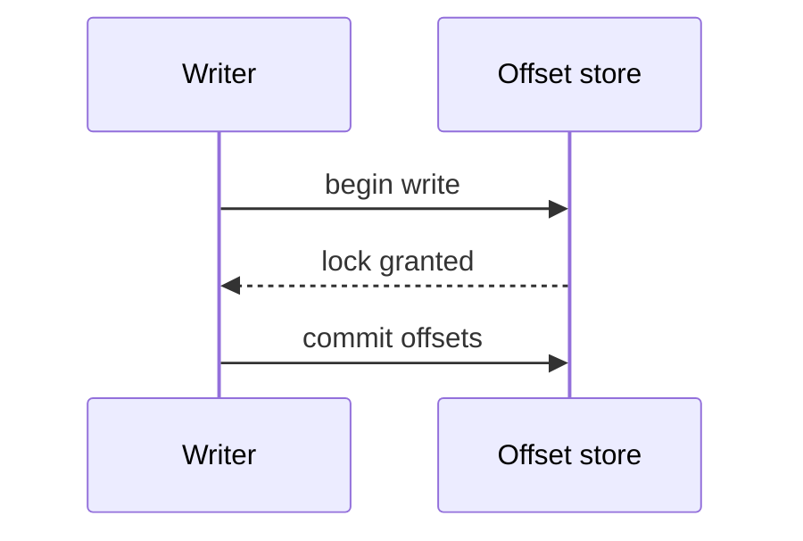

# Style

How to draft and revise writeups. `calamus-synth check` flags some of
these rules mechanically; the rest depend on judgment. Each rule has a
short pair from a synthetic project, a log ingester. Citations in the
pairs are shortened to `[a]`, `[b]`, `[c]`.

## Craft rules

### 1. Lead with the claim

The first sentence of a paragraph says what happened or what it means.
Evidence follows.

> Before: Over several weeks a number of buffering approaches were
> explored, and after evaluating them the team settled on one.
>
> After: The ingester buffers to disk, not memory [a]. Three in-memory
> designs came first, and each failed the 2 GB replay test [b].

### 2. Narrate a pivot in causal order

State before, trigger, decision, consequence.

> Before: The project switched to SQLite. It had used flat files.
> Concurrent writers corrupted an index during the March load test.
>
> After: Until March the ingester kept offsets in flat files [a]. A load
> test with four writers corrupted the offset index twice in one run [b].
> The store moved to SQLite in write-ahead mode, and the same test has
> passed on every nightly run since [c].

### 3. Use the record's specifics

A sentence that would fit any project is cut or made specific: name the
file, the number, the rejected option, the failing test.

> Before: Performance improved significantly after the change.
>
> After: Median replay time fell from 41 s to 9 s on the nightly
> fixture [a].

### 4. One idea per paragraph; say how ideas relate

Use transitions that state the relation: because, so, but, which meant.

> Before: Additionally, the retry logic was simplified. Furthermore,
> timeouts were added.
>
> After: Timeouts made the retry logic simpler, because a stalled read
> now ends in a known error instead of a hang [a].

### 5. Prose argues, tables compare, bullets list

Use a table when three or more options share attributes. Use bullets only
for three or more parallel items that need no connective.

> Before: a bullet list of "SQLite: safe", "Flat files: fast",
> "Postgres: heavy".
>
> After: a table with columns Option, What it offered, Why it lost, and a
> sentence before it saying which option won and why [a].

### 6. Cite at the end of the sentence

At most three ids per sentence.

> Before: In [a], the [b] decision made in [c] to use write-ahead mode let
> readers continue.
>
> After: Write-ahead mode let readers continue during writes [a][b].

### 7. Describe events, not the journal

No tag names, no "the entry records", no "according to the journal".

> Before: The CP-PIVOT entry on 2026-03-02 records that the team pivoted
> to SQLite.
>
> After: On 2026-03-02 the offset store moved to SQLite [a].

### 8. Define a term at first use

> Before: The WAL fixed the LSN drift.
>
> After: Write-ahead logging (WAL) fixed a drift in log sequence numbers,
> the counters that order replayed records [a].

### 9. Open the overview with a thesis

Three sentences: what was built, the decision that shaped it, where it
ended.

> After: The project built an ingester that replays production logs into
> a test cluster [a]. One decision set its shape: buffering to disk,
> which traded latency for surviving restarts [b]. It ended as a nightly
> job with multi-region replay still unsolved [c].

### 10. Run the reader test

Read only the first paragraph of each file. A reader who has not seen the
journals should be able to say what changed and why. If not, rewrite that
paragraph first.

## Code excerpts

An excerpt earns its place only when the prose around it points into it.

- Before it, one sentence says what to look at ("The guard on line 3
  rejects offsets from a stale epoch").
- After it, one sentence says what followed.
- Prefer the interface, guard, or configuration that embodies the
  decision over a whole function body.
- One excerpt per pivot, or one diff. At most four per file.
- Never edit an excerpt block. To show fewer lines, run `excerpt` again
  with `--lines` or `--max-lines`.

## Mechanism diagrams

Write an `extra-<topic>.mmd` when a decision depends on an order of events
or a set of states that prose makes hard to follow: a hook firing
sequence, a retry state machine, data passing between three or more
components. Do not draw a list of steps that a paragraph handles, or
anything the generated diagrams already show.

- Use `flowchart`, `sequenceDiagram`, or `stateDiagram-v2`.
- Start with `%% sources: <ids>` naming the entries it depicts.
- Show only components and steps those entries name. Twelve nodes at
  most.
- Declare every node or participant with a label before an edge uses it.
- Write `#34;` for a double quote inside a label.

## Revising lint findings

`check` reports these as `WARN`. Fix the sentence, not the number: a
rewrite that satisfies the rule but loses meaning is worse than the
warning. Stop after two passes.

| Rule | What to do |
|---|---|
| `stock-phrase` | Replace the phrase with the specific fact it stands in for |
| `filler-transition` | Delete the transition or state the actual relation |
| `stacked-hedge` | Keep one hedge, the one the evidence supports |
| `repeated-opener` | Vary the subject or merge two of the sentences |
| `vague-referent` | Name what "this" or "it" refers to |
| `contrast-frame` | State the claim directly |
| `empty-intensifier` | Give the number, or drop the word |
| `tag-leak` | Describe the event instead of naming the tag |
| `citation-clutter` | Split the sentence or cite the strongest entries |
| `bullet-heavy` | Turn connected bullets into a paragraph |
| `band-mean-length` | Split long sentences or join fragments |
| `band-long-sentences` | Split at the main clause |
| `band-short-sentences` | Join short sentences that share a subject, or split long ones |
| `band-paragraph-length` | Split or merge paragraphs around one idea each |
| `band-em-dash` | Use a comma, colon, or new sentence |
| `band-exclamation` | Use a period |
| `band-first-person` | Name the actor or use the system as subject |
| `band-contraction` | Write the words out |
